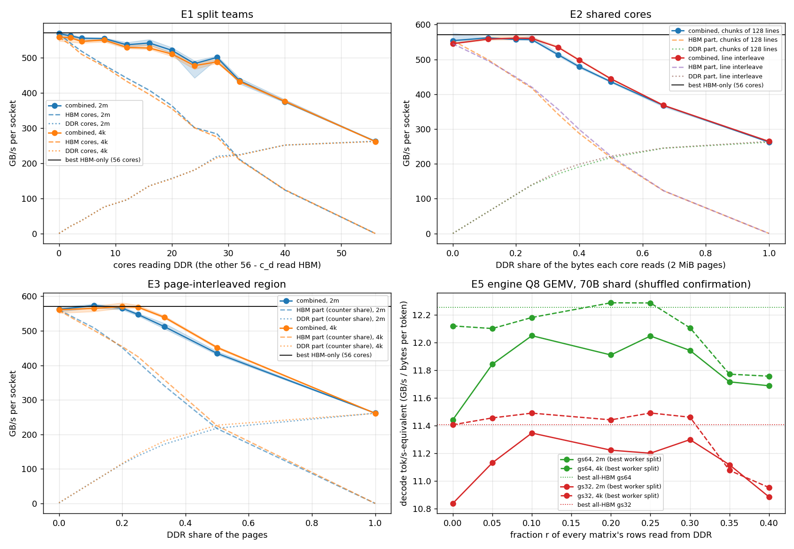

# Concurrent HBM and DDR reads on one socket: does combined bandwidth exceed HBM-only?

Measurements on CRESCO8 Flat/Quadrant nodes (dual Xeon Max 9480; per socket 56 cores, 64 GB HBM = NUMA nodes 2 and 3,
about 512 GB DDR5 = NUMA nodes 0 and 1). Program: `tests/stream_bench.c` in `--exp` mode; job script
`scripts/concurrent-tier.sbatch`; analysis, tables and figure `tools/concurrent_tier.py`. Evidence, job ids and checks are in
[concurrent-tier-bandwidth-validation.md](concurrent-tier-bandwidth-validation.md). GB/s means 1e9 bytes per second. Every
number is labelled **measured**, **derived** (arithmetic on measured numbers), **modelled** or **estimated**. "Median [min-max]" is over
7 repetitions (the base sweep uses 3). The reference for every gain is the best HBM-only measurement made with the same kind of data
(pseudo-random bytes).

## 1. Answer

1. **No.** With a socket's 56 cores reading HBM and DDR at the same time, the combined read bandwidth never exceeded the best
   HBM-only bandwidth in any of the four ways of mixing the tiers (split teams, shared cores, interleaved pages, both sockets at
   once). The best HBM-only figure is **569.1 [554.2-571.2] GB/s per socket** (measured, 2 MiB pages, 56 cores, one stream per
   core, 16 KiB software prefetch; the largest single median, 570.6, comes from a fixed-volume window of the same configuration).
   The best mixed point is **562.4 [553.9-568.0]** (54 HBM + 2 DDR cores), about 1% below it; the E2 and E3 maxima (561 and 573.4
   [567.0-577.4]) lie inside the HBM-only run-to-run range. Adding DDR cores beyond that point lowers the combined rate
   monotonically, to 501 at 28+28 and 262 for DDR only. Run-to-run spread of the HBM-only reference is about 3% (554-571), so a gain of
   less than about 3% could not be seen even if it existed.
2. **The engine's own decode GEMV does not gain either.** Over the 70B per-socket shard (gs64), the best all-HBM configuration
   (4 KiB pages, 56 workers) reads **447.2 [440.6-451.7] GB/s** (12.12 decode tok/s-equivalent). The best split of every matrix's rows
   between an HBM and a DDR copy reads 453.4 [442.5-459.8] GB/s (12.29 tok/s-equivalent): +1.4%, ranges overlapping, in a run in
   which every process used its own shuffled configuration order. gs32 gives the same picture (445.6 against 449.0, +0.7%).
3. **Why** (section 6): the package sits at its power limit in every run (348-355 W per socket, measured, including DDR-only), and
   the core clock falls from 2.28 GHz (DDR only) to 1.4-1.7 GHz as soon as cores read HBM while the uncore clock rises with the DDR
   share (1.7 to 2.1 GHz). DDR itself saturates at 28 cores (266 GB/s) and adds latency (up to 366 ns under load). The data show
   power-limited, not controller-limited, behaviour; they do not prove it, because no frequency or power knob could be set.
4. **Two side findings that matter for any bandwidth benchmark:** (a) all-zero memory reads 6% faster than pseudo-random data
   under the same power cap (565.8 against 600.9 GB/s HBM-only); (b) the engine's Q8 GEMV reads 11% more slowly from 2 MiB pages
   than from 4 KiB pages (401 against 447 GB/s at 56 workers), unrelated to address alignment.

Figure (measured, medians with min-max bands): E1 against DDR cores, E2 and E3 against the DDR share of the bytes, E5 as
tok/s-equivalent against the DDR row fraction r with the best all-HBM level of each group size. The black line is the best HBM-only
reference. Page-interleaved (E3) HBM and DDR parts are the combined rate split by the share of the counter bytes seen on each tier.

## 2. Method

* **Windows.** Every measurement is a window in which all workers of a socket start at a shared absolute time, run 0.2 s unmeasured,
  then 1.0 s measured (the base sweep 0.15 + 0.5 s). Each worker counts the bytes it read and its own duration; a tier's rate is the
  sum over its workers of bytes / duration, so for the timed windows both groups are active for the whole measured period and the combined
  rate is the whole-window rate. For a fixed-volume window (`e1v`) every worker reads the same volume (6 GiB); then the
  total volume / total time (last finisher) and the rate over the interval in which all workers were still running are reported
  separately. GEMV windows are 2 warm-up and 16 measured passes over 40 layers (18.2 GB at gs64, 19.3 GB at gs32 per tier copy).
* **Memory.** Each socket's HBM region and DDR region are 20 GiB (above the 16 GiB floor), bound to the local nodes before first
  touch and filled with pseudo-random bytes by the socket's own workers. Two page sizes: 2 MiB (THP, madvise) and 4 KiB (THP
  disabled for the region). Every page was verified with `move_pages` at setup and again at the end (5.1e9 page queries, all on the intended node;
  validation document). E3 regions (32 GiB) are built page by page with `set_mempolicy` and verified page by page; the kernel (5.14) has
  no weighted interleave.
* **Read kernel.** AVX-512 64-byte loads, `S` lockstep streams per core, software prefetch distance, hint and optional non-temporal loads,
  all swept in the base stage. The GEMV is the engine's `k_matmul_q8_ld_worker` (VNNI W8A8), called by each worker for its share of rows
  of its tier's copy, with the engine's phase structure (qkv | wo | w1,w3 | w2) and a team barrier after each. Weights are int8 in
  [-127, 127] from a linear congruential generator, scales 0.002 + 0.0001 x ((row + group) mod 7).
* **Counters.** `perf stat -a --per-socket -I 100` ran during every process: DDR CAS reads (x 64 B), HBM CAS reads (x 32 B), UPI
  data flits, RAPL package and DRAM energy, cycles and reference cycles. Each window is a burst of traffic between idle gaps; the
  measured bytes of a window are the counter bytes of its burst, to be compared with the bytes the workers issued (validation document).
* **Order and interleaving.** Repetitions loop outside the process and the two page sizes alternate, so page sizes and repetitions
  are interleaved in time. Inside one process the configurations ran in fixed file order, except the final job (E3, E4, the data
  comparison and the E5 confirmation), which shuffled the order inside each process.
* **Nodes.** All numbers above were measured on one node (hbm14); the key E1 and E5 points were repeated on a second Flat node
  (hbm13) and agree within 1.6% (section 8).

## 3. Reference: best HBM-only and DDR-only

Base sweep (3 repetitions, 214 configurations, both page sizes): cores x streams x prefetch distance x hint x non-temporal.

| quantity (measured, per socket) | median [min-max] GB/s |
|---|---|
| best HBM-only, 56 cores, S=1, pf 16 KiB, 2 MiB pages (base, 3 reps) | 575.5 [563.7-579.9] |
| same, 7 reps in E1 | 569.1 [554.2-571.2] |
| same, 4 KiB pages, 7 reps | 558.5 [547.8-570.0] |
| HBM-only at the same settings, E6 (7 reps) | 565.1 [557.4-586.7] |
| best DDR-only, 28 cores, no prefetch | 266.4 [265.3-268.1] (base); 265.8 [264.8-266.4] (E1) |
| DDR-only, 56 cores | 262.5 [262.1-262.8] |

HBM-only against cores (E1 reference points, 2 MiB pages, measured): 16 cores 219.6, 24 312.5, 28 354.0, 32 395.9, 40 460.3, 44 489.4,
48 514.7, 52 542.6, 56 569.1 GB/s. Per core (derived) that is 13.7 GB/s at 16 cores falling to 10.2 GB/s at 56, and the curve is still
rising at 56 cores. DDR-only: 16 cores 202.7, 24 249.6, 28 265.8, 32 263.2, 40 262.0 (derived per core 12.7 at 16, 9.5 at 28): DDR saturates at
about 28 cores, as the earlier controller measurements say.

E6 sensitivity of the HBM-only rate (2 MiB pages, 7 reps; measured): one stream per core is best (563 against 542 with 4 streams and
515 with 8); a longer prefetch is slightly better (16 KiB 563-566, 8 KiB 566, none 542-550); non-temporal loads 568 against 560, no effect; the T1 hint loses 6%
(531) and the NTA hint halves the rate (231 GB/s, and the counters show 1.45 times the bytes the program asked for, so the hardware fetches each line
twice). Spreading the DDR cores across the team (`alt`) instead of a block makes no difference. Hardware prefetchers and the uncore
frequency cannot be changed with this account (sudo is limited to `perf stat`, `turbostat` and `ipmitool sensor`; no MSR tools;
uncore limits not writable): not tested.

## 4. Results of the mixing experiments (per socket, measured)

### E1 split teams (c_h cores read HBM, c_d cores read DDR, c_h + c_d = 56)

| HBM + DDR cores | HBM GB/s | DDR GB/s | combined 2 MiB | combined 4 KiB | fixed-volume run: total volume / total time (2 MiB) | core GHz | package W |
|---|---|---|---|---|---|---|---|
| 56 + 0 | 569.1 | 0 | 569.1 [554.2-571.2] | 558.5 [547.8-570.0] | 549.1 [524.8-564.3] | 1.68 | 354 |
| 54 + 2 | 542.1 | 20.3 | 562.4 [553.9-568.0] | 557.5 [544.6-562.3] | 550.6 [528.7-556.6] | 1.62 | 353 |
| 52 + 4 | 518.7 | 37.0 | 555.9 [551.8-557.5] | 546.5 [542.2-551.0] | 535.9 [514.8-543.0] | 1.44 | 353 |
| 48 + 8 | 479.3 | 75.5 | 554.8 [548.2-556.8] | 550.8 [545.5-554.6] | 515.7 [488.6-523.7] | 1.42 | 351 |
| 44 + 12 | 442.3 | 95.4 | 537.1 [530.9-543.9] | 529.4 [526.3-534.8] | 453.4 [439.7-464.4] | 1.43 | 354 |
| 40 + 16 | 407.6 | 135.5 | 542.2 [535.9-552.4] | 527.9 [524.4-538.6] | 492.1 [469.6-495.4] | 1.41 | 352 |
| 36 + 20 | 363.5 | 156.9 | 521.2 [513.6-529.1] | 510.8 [504.4-514.1] | 461.4 [451.9-464.9] | 1.36 | 353 |
| 32 + 24 | 301.1 | 180.4 | 483.4 [442.7-491.4] | 477.8 [467.5-487.2] | 440.5 [437.3-443.5] | 1.21 | 353 |
| 28 + 28 | 283.3 | 219.7 | 501.1 [496.9-505.4] | 488.4 [485.0-494.8] | 455.0 [450.0-457.4] | 1.36 | 353 |
| 24 + 32 | 210.7 | 224.3 | 434.7 [425.9-442.2] | 432.3 [430.1-435.5] | 407.7 [400.6-414.2] | 1.17 | 352 |
| 16 + 40 | 123.7 | 251.4 | 375.1 [372.8-381.2] | 376.2 [374.3-379.6] | 355.3 [354.1-359.1] | 1.75 | 352 |
| 0 + 56 | 0 | 262.5 | 262.5 [262.1-262.8] | 261.7 [260.9-261.8] | 260.8 [260.2-261.2] | 2.28 | 352 |

HBM and DDR columns are 2 MiB pages. Core GHz is the median over repetitions of cycles / reference cycles x 1.9 GHz over the interior
intervals of each window, all 56 cores of the socket (including idle spinning workers), so it is an average over cores, not the clock of one core.
Best split: 56 + 0, i.e. no DDR at all; the best window with DDR is 54 + 2, 1.2% below the HBM-only median (ranges overlap). The
fixed-volume column is lower than the fixed-time column wherever the two groups finish at different times (28 + 28: 455 against 501 GB/s);
during the interval in which both were running the groups read at the fixed-time rates (for 28+28, 287.9 HBM and 223.2 DDR GB/s in the
common interval of the volume run). The doc's reported combined value is the fixed-time one.

### E2 shared cores (all 56 cores read both tiers in a fixed byte ratio)

| HBM:DDR bytes | DDR share | combined, line interleave | combined, chunks of 128 lines (8 KiB) | HBM part / DDR part (chunks) |
|---|---|---|---|---|
| 1:0 | 0 | 544.9 [543.5-547.9] | 553.9 [545.7-576.3] | 553.9 / 0 |
| 8:1 | 0.11 | 558.2 [553.7-566.1] | 561.8 [555.5-563.9] | 499.4 / 62.4 |
| 4:1 | 0.20 | 561.2 [555.0-568.5] | 557.2 [555.5-560.5] | 445.7 / 111.4 |
| 3:1 | 0.25 | 560.1 [555.9-565.4] | 556.6 [554.1-569.0] | 417.5 / 139.2 |
| 2:1 | 0.33 | 534.5 [532.7-539.4] | 513.4 [508.1-519.2] | 342.2 / 171.1 |
| 3:2 | 0.40 | 497.6 [495.8-502.2] | 478.9 [473.6-484.3] | 287.3 / 191.5 |
| 1:1 | 0.50 | 444.3 [440.1-447.2] | 435.8 [431.8-439.1] | 217.9 / 217.9 |
| 1:2 | 0.67 | 368.0 [365.8-370.2] | 367.4 [361.6-369.1] | 122.5 / 244.9 |
| 0:1 | 1 | 264.3 [264.0-264.4] | 262.2 [261.9-262.4] | 0 / 262.2 |

Chunk sizes of 8, 32 and 512 lines give the same combined rate at 3:1 (544.9, 551.5, 554.1) and 1:1 (440.9, 439.4, 433.7). 4 KiB pages: maximum 559.0
(4:1 line). The HBM-only reference is exceeded by none (561.2 against 569.1 [554.2-571.2]).

### E3 page-interleaved region (one 32 GiB region, pages placed HBM:DDR; all cores read it uniformly; pseudo-random data)

| HBM:DDR pages | page share on DDR | DDR share of the counter bytes | combined 2 MiB | combined 4 KiB |
|---|---|---|---|---|
| 1:0 | 0 | 0.002 | 562.1 [555.3-568.5] | 561.0 [551.2-566.2] |
| 8:1 | 0.111 | 0.113 | 573.4 [567.0-577.4] | 565.1 [556.1-571.6] |
| 4:1 | 0.200 | 0.202 | 565.5 [561.2-570.2] | 570.1 [565.9-581.2] |
| 3:1 | 0.250 | 0.252 | 547.3 [543.4-550.7] | 568.6 [566.2-574.3] |
| 2:1 | 0.333 | 0.335 | 512.1 [506.1-521.7] | 539.1 [536.2-543.4] |
| 1:1 | 0.500 | 0.501 | 434.7 [430.7-440.6] | 451.8 [448.6-454.9] |
| 0:1 | 1 | 0.999 | 261.7 [261.6-262.1] | 260.9 [260.5-261.0] |

The counters confirm the placement (the DDR share of the bytes equals the page share). The best point (8:1, 2 MiB: 573.4 [567.0-577.4]) is 0.7% above the E1
HBM-only median and 2% above this region's own all-HBM point; its range overlaps the HBM-only range (554-571), so it is not
a demonstrated gain. The first E3 run (job B) used a region whose pages were touched but never written (all zeros): it read
602.7 GB/s all-HBM and 611.7 at 8:1; those numbers are **not comparable** with the E1 reference and are only used in section 7.

### E4 both sockets at once (each socket reads only its own HBM and DDR; node totals; 7 reps)

| config | 2 MiB node GB/s | 4 KiB node GB/s |
|---|---|---|
| HBM-only, 56 + 56 cores | 1127.8 [1102.1-1148.8] | 1120.3 [1096.4-1140.3] |
| best E1 split (the E1 optimum is 56+0, so identical) | 1141.4 [1120.8-1234.4] | 1119.4 [1106.8-1128.9] |
| shared 8:1 | 1131.7 [1114.5-1146.1] | 1119.1 [1093.2-1135.7] |
| interleaved pages 8:1 | 1167.8 [1113.1-1180.2] | 1130.4 [1108.2-1151.6] |
| DDR-only | 524.8 [524.5-525.6] | 523.8 [522.9-524.3] |

Per node the best HBM-only is 1127.8 GB/s (2 x 563.9, derived from two sockets running together: 0.99 of 2 x 569.1), and the best mixed point 1167.8
(+3.5%, ranges overlapping). UPI traffic (rx + tx data flits; flit = 64/9 byte assumed, so an estimate) is 0.12-0.21 GB/s for HBM-only, DDR-only and shared
runs, about 1.5 GB/s in the interleaved 2 MiB runs (0.1% of the traffic): essentially zero cross-socket traffic.

## 5. E5: the engine's Q8 decode GEMV over the 70B per-socket shard

Shard (per socket, 2-socket tensor parallel): Wq 4096x8192, Wk and Wv 512x8192, Wo 8192x4096 (column shard), W1 and W3 14336x8192,
W2 8192x14336, 40 layers per tier copy (18.2 GB gs64, 19.3 GB gs32). Rows of every matrix are split between an HBM copy and a DDR copy
in the ratio r (DDR fraction). tok/s-equivalent (derived) = GB/s / 36.9 GB (gs64) or / 39.1 GB (gs32) per socket per token; it ignores
attention, the classifier and communication.

All-HBM GEMV against the number of workers (measured, 7 reps, file order, GB/s): 14 workers 157, 28 272, 32 317, 40 363, 42 367, 48 398,
52 418, 56 403 (2 MiB pages, gs64); 4 KiB pages 325.9 (32), 373.1 (40), 405.4 (48), 432.5 (52), 443.6 (56). The kernel reaches 11.2 GB/s per worker at 14
workers and 7.2 at 56 with 2 MiB pages (8.0 with 4 KiB; derived), i.e. 71% (2 MiB) to 80% (4 KiB) of the stream rate at 56 cores. The package power is 350-353 W at every worker count (counters), and the core clock falls from 2.27 GHz at 14 workers to
1.86-1.99 GHz at 52-56 (measured; the stream at 52-56 cores runs at 1.6-1.7 GHz), so the GEMV is not
bound by the core clock in the way the stream is, and it does not saturate HBM (447 against 569 GB/s). Because the kernel uses less
HBM bandwidth than a stream does, moving rows to DDR could in principle relieve a per-core limit; the measurement shows it does not.

Shuffled confirmation (every process runs its configurations in its own random order; 2 MiB and 4 KiB alternate; 7 reps; gs64, tok/s-eq.
in brackets; the best all-HBM point over both page sizes and all worker counts is 447.2 [440.6-451.7] GB/s, 4 KiB, 56 workers):

| config | 2 MiB GB/s | 4 KiB GB/s | 4 KiB vs best all-HBM |
|---|---|---|---|
| all-HBM, 48 workers | 402.9 [398.1-404.9] | 403.3 [395.5-410.9] | -9.8% |
| all-HBM, 52 workers | 422.2 [408.5-426.8] | 427.0 [420.7-434.5] | -4.5% |
| all-HBM, 56 workers | 400.9 [398.1-406.0] | **447.2 [440.6-451.7]** (12.12) | 0 |
| r = 0.05, 3 DDR workers | 437.0 [432.7-441.3] | 446.5 [441.6-454.3] | -0.2% |
| r = 0.10, 6 DDR workers | 444.6 [438.7-446.9] | 449.5 [439.4-454.8] | +0.5% |
| r = 0.20, 14 DDR workers | 439.5 [430.6-444.2] | **453.4 [442.5-459.8]** (12.29) | +1.4% |
| r = 0.25, 18 DDR workers | 444.5 [435.1-453.6] | 453.4 [442.7-456.5] | +1.4% |
| r = 0.30, 21 DDR workers | 440.7 [433.5-449.3] | 446.7 [443.0-458.1] | -0.1% |
| r = 0.35, 24 DDR workers | 432.3 [429.1-442.1] | 434.4 [428.0-438.5] | -2.9% |
| r = 0.40, 28 DDR workers | 431.3 [430.3-435.9] | 433.8 [432.8-439.9] | -3.0% |

gs32 (best all-HBM 445.6 [442.3-446.7] GB/s, 11.41 tok/s-eq.): best split r = 0.10-0.25 about 447-449 GB/s (+0.3 to +0.7%); 2 MiB all-HBM 405.4. Earlier runs in file order gave 2 MiB splits
of up to 447 GB/s against a 2 MiB all-HBM 56-worker point of 401-405 (+10%), but that is a comparison against a poor baseline: with 4 KiB
pages the all-HBM kernel alone reaches 447. Against the best all-HBM point the split is within +-1.5%, with overlapping ranges: **no demonstrated gain**.
Rows split in the E2 style (every worker reads both tiers) is 2-7% worse than the best worker split (415.9-438.4 GB/s in the file-order run, against 446.8).
Split with too few DDR workers is much worse (r = 0.25 with 10 DDR workers: 330 GB/s) because the DDR group finishes last.

Beyond r = 0.3 the total falls: all-DDR reads 250-253 GB/s (6.8 tok/s-eq.).

**Page-size finding.** Reading the shard from 2 MiB pages is 11% slower than from 4 KiB pages at 56 workers (400.9 against 447.2 GB/s gs64; 405.4 against 445.6 gs32)
and equal at 48 workers (402.9 against 403.3). Adding a constant byte offset of 64 B, 4 KiB, 64 KiB or 1 MiB + 64 B to every weight address changed nothing
(2 MiB: 400.9-402.5; 4 KiB: 438-448), so the effect is not an alignment effect of the row blocks within 2 MiB pages. The cause was not found. Because the
engine also runs weights on THP, this matters beyond this study (estimate: up to about 10% of decode bandwidth at 56 workers).

## 6. Why the curve has this shape

Everything below is supported by counters measured in the same windows.

1. **The package is at its power limit in every window.** RAPL package power is 351-354 W per socket (measured; the part's TDP is 350 W) in HBM-only,
   every E1 split, DDR-only and the GEMV runs, with DRAM power rising from 22 W (HBM-only) to 74 W (DDR-only). Turbostat on the long windows gives
   the same 349 W.
2. **The core clock is where the power goes.** The average core clock is 1.68 GHz in HBM-only, 1.4 GHz in most mixed splits and 2.28 GHz in
   DDR-only; the uncore clock (turbostat, package 0, median of the seconds inside the window) is 1.7 GHz [1.5-1.9] HBM-only, 1.9 [1.3-2.0] at 48+8,
   2.0 [1.9-2.2] at 28+28 and 2.1 [2.0-2.3] DDR-only, while the clock of core 0 (a worker of the HBM group) is 1.69, 1.47, 1.36 and 2.19 GHz.
   Reading HBM pulls the clocks down; reading DDR does not. Adding DDR traffic therefore adds DRAM power to a budget that is already full and
   pushes cores (and with them the HBM group) to lower clocks instead of adding bandwidth.
3. **Data content changes bandwidth at the same package power.** Over all-zero pages the HBM-only rate is 600.9 [595.7-609.3] against 565.8 [559.6-573.6] GB/s
   over pseudo-random pages (+6.2%), at 351 and 352 W and 1.75 against 1.64 GHz; the 4:1 shared point 598.5 against 559.0, the 48+8 split 584.9 against 555.5,
   the all-HBM GEMV 5% (52 workers: 444.1 against 421.8). The memory interface power depends on the data, and a power-capped part turns the saved watts into clock and
   bandwidth. A bandwidth ceiling set by the controllers would not move with the content.
4. **HBM is not saturated at 56 cores and is not limited by the controllers.** HBM-only still gains 5% from 52 to 56 cores (542.6 to 569.1) with
   per-core rates falling from 13.7 to 10.2 GB/s: a mix of per-core request concurrency and the clock. Loaded latency (one core chasing pointers while the others stream,
   measured): HBM 156 ns idle, 206 ns with 55 cores streaming HBM; DDR 132 ns idle, 160 ns with 55 cores streaming HBM, 366 ns with 55 cores streaming DDR (DDR saturated),
   241-271 ns with 8-28 DDR streamers. A DDR access costs more queueing than an HBM one and DDR gives at most 262-266 GB/s.
5. **Mixed configurations lose on both sides.** At 48 + 8, the 8 DDR cores read 75.5 GB/s (9.4 GB/s per core) and the 48 HBM cores 479.3 GB/s (10.0 per core), against 12.7 GB/s per core for
   DDR at 16 cores alone and 10.2 per core for 56 HBM cores; the combined rate is the sum of two reduced streams. Fixed-volume runs show the second effect: the group with fewer cores
   per byte finishes last, so total volume / total time falls up to 16% below the fixed-time rate (44+12: 453 against 537 GB/s; 28+28: 455 against 501).
6. **The GEMV does not escape.** It uses 71-80% of the stream rate with 56 workers at lower power-limited clocks (1.9-2.0 GHz) and rises almost linearly with
   workers to 52; DDR workers added to the HBM workers draw their share of the same package budget, and every split stays within 1.5% of the all-HBM level.

Whether the limit is power or bandwidth: the curves, the clocks, the constant package power and the data-content effect all point to the package power budget;
HBM and DDR hardware ceilings (DDR 262-266 GB/s at 28 cores) bound the DDR side but not the sum. What this study cannot show is a counterfactual (the same run at a fixed
higher clock), because core and uncore frequency cannot be set with this account.

## 7. Modelled 70B decode speed implied (per socket, 36.9 GB per token at gs64)

From the E1 per-tier rates measured under concurrency (random data). t_concurrent = max(B_hbm / BW_hbm(c_h), B_ddr / BW_ddr(c_d)) with the byte
fraction f = BW_ddr / (BW_hbm + BW_ddr) at which both groups finish together; t_serial = B_hbm / BW_hbm(56 cores, HBM-only) + B_ddr / BW_ddr(56 cores, DDR-only); all-HBM is B / 570.6 GB/s (modelled; the engine's kernel reaches 447 GB/s, i.e. 12.1 tok/s, in E5).

| HBM + DDR cores | DDR byte fraction f | tok/s concurrent | tok/s serial tiers | tok/s all-HBM |
|---|---|---|---|---|
| 54 + 2 | 0.036 | 15.24 | 14.84 | 15.46 |
| 52 + 4 | 0.067 | 15.06 | 14.36 | 15.46 |
| 48 + 8 | 0.136 | 15.03 | 13.36 | 15.46 |
| 44 + 12 | 0.177 | 14.57 | 12.83 | 15.46 |
| 40 + 16 | 0.250 | 14.72 | 12.00 | 15.46 |
| 36 + 20 | 0.301 | 14.10 | 11.47 | 15.46 |
| 28 + 28 | 0.437 | 13.63 | 10.27 | 15.46 |
| 16 + 40 | 0.670 | 10.17 | 8.71 | 15.46 |

Concurrent reading is always better than reading the tiers one after the other (the current hybrid placement keeps whole layers in one tier, so it reads them
serially): +2.7% at 54+2 up to +33% at 28+28 (modelled). It is always worse than all-HBM, so it is only useful when part of a model does not fit in HBM: if a
fraction f = 0.25 of the bytes must live in DDR, the concurrent model gives 14.72 tok/s against 12.00 tok/s when the tiers are read one after the other (modelled, both
for gs64 and bytes per token 36.9 GB; the engine's real kernel reaches about 79% of these rates, 12.1 tok/s all-HBM).

## 8. Replication and energy

* Replication on a second Flat node (hbm13, 7 reps): E1 cd 0, 4, 8, 16, 28, 56 and the fixed-volume point at both page sizes differ from hbm14 by -1.6% to +0.9%
  (for example 56+0: 566.5 against 569.1; 28+28: 493.2 against 501.1; DDR only 262.4 against 262.5). E5 on hbm13 (file order, 7 reps, gs64): all-HBM with 56 workers is again 405.7 [402.7-408.8] GB/s at 2 MiB and 444.1 [437.0-453.1] at 4 KiB; the best split is r = 0.1 with 6 DDR workers, 445.5 [437.5-448.3] (2 MiB) and 453.1 [451.9-457.8] (4 KiB, +2.0%); gs32 gives 455.1 [449.8-456.4] against 444.9 [442.5-452.9] (+2.3%). On this node the split is therefore 2% ahead of the best all-HBM point with ranges that touch; on hbm14 (shuffled run) it is +0.5% (r = 0.1) to +1.4% (r = 0.2). The gain is below the 3% run-to-run spread and is not demonstrated.
* Energy per byte (socket 0, measured RAPL package + DRAM over the interior intervals of the window; the node idles at 348 W package, 22 W DRAM with the worker teams spinning):
  HBM-only 569 GB/s at 354 + 22 W = 0.66 J/GB; DDR-only 263 GB/s at 352 + 74 W = 1.62 J/GB; 48+8 0.71 J/GB; 28+28 0.84 J/GB (derived, J per GB of reads). Above the spinning-idle baseline, HBM-only costs
  0.010 J/GB and DDR-only 0.212 J/GB (derived): the incremental energy of a DDR byte is about 20 times that of an HBM byte, but the package budget is the binding quantity.

## 9. Limits and uncertainties

* The conclusions are about read streams and the engine's decode GEMV; writes, attention and KV traffic were not mixed in.
* Run-to-run spread of the HBM-only reference is 3% (7 reps, interleaved); a mixed configuration within about 3% of it cannot be called a loss or a gain. No configuration exceeded it by more than its own spread.
* Core clock is an average of 56 cores of the socket including spinning idle workers; turbostat uncore values are one-second samples of package 0.
* The power-cap explanation is consistent with every counter but unproven (no frequency or power control).
* The 2 MiB GEMV slowness is unexplained.
* UPI bytes use an assumed 64/9 bytes per data flit.
