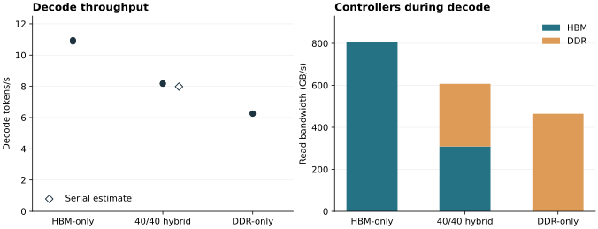
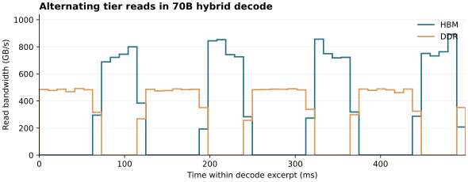
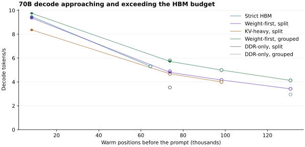

# Hybrid HBM and DDR for Llama 3.1 70B inference

> **Measured on an older tree (the earlier 70B comparison work, before the prefill, Wo/W2 and gs32/gs64 kernel work); numbers are not comparable with current-tree measurements.**

Numbers are measured unless the text says modelled, derived or estimated. The serial-time predictions (for example 7.99 tok/s) and the attention-saving predictions are modelled; GB per step is derived from measured counter rates, the CAS transfer sizes and the phase duration; the logical read volumes are derived from the checkpoint shapes. The raw directories are not in the repository; [the validation record](hbm-ddr-research-validation.md) lists the jobs.

The 40/80-layer hybrid pilot decoded at **8.18 tok/s**, between **10.91** for HBM-only and **6.25** for DDR-only. A model that adds the times spent reading the two tiers predicts **7.99 tok/s** from timing controls. The aggregate controller rates support this explanation. The hybrid run read approximately the same number of bytes per step as the two controls, split almost evenly between memory tiers.

## Scope and hypotheses

This study uses the Llama 3.1 70B Instruct v3 Q8_0 checkpoint with 64-element quantization groups, FP32 KV, and one active stream. The engine baseline is feature revision `1bc9189`, the placement branch that `develop` now contains. The pre-port revisions of the jobs below add instrumentation and experiments around that engine. The study pinned the feature revision because `develop` at `5c0dd56` has different prefill kernels and batched tensor-parallel reductions; `develop` has since gained the prefill, Wo/W2 and gs32/gs64 kernel work as well.

| Hypothesis | Discriminating observation |
| --- | --- |
| The 40/80 baseline mostly serializes reads across layer groups. | At fixed workload and clocks, the sum of the isolated tier times predicts hybrid throughput and the measured per-tier bytes follow the plan. |
| Weight and KV spill have different marginal costs. | Swap which class spills at fixed active depth. At high reservation, compare two plans using approximately the same HBM budget. |
| The controllers can serve useful reads concurrently when work is independent. | Compare concurrent and serial runs over identical HBM and DDR buffers on separate core sets of the same socket. Measure completion time and controller rates. |
| DDR AMX packs isolate prefill storage from decode-critical weights. | Repeat a matched AMX request with the packs in DDR in both modes. Compare verified placement, TTFT, decode, and peak RSS. |
| FP32 KV traffic scales with live depth at fixed reservation. | Hold reservation fixed and measure real warmed positions and bytes read at different active depths. |

## What the engine executes

The checkpoint supplies the original projections and group scales through its tensor manifest. Two socket teams retain local shards. Q/K/V and W1/W3 are row sharded, Wo/W2 are column sharded, and the classifier is split by vocabulary. The startup planner binds separate HBM and DDR arenas before loading. Both sockets use identical weight and KV layer cutoffs. An untied input embedding and load scratch default to DDR under hybrid. Work, exchange, and norms stay in HBM. See the [manifest and loader](../src/shards.c), [planner and forward pass](../src/tp.c), and [NUMA binding](../src/numa.c).

In decode, the teams stream original weights for QKV, compute attention over their local live KV, then execute Wo, W1/W3, and W2. Each layer depends on the previous residual, and the TP teams exchange partials after Wo and W2. Projection and exchange can overlap within a reduction. With the same weight and KV cutoff, both teams normally use the same tier for the heavy reads throughout a layer. With different cutoffs, attention and projection can alternate tiers inside a layer, while the forward calls remain dependent.

AMX-INT8 prefill consumes each layer’s packed matrix copy and the original quantization scales. Pack placement can differ from original weight placement. Decode streams the original quantized representation. The planner charges the full KV reservation at startup, but physical KV pages are populated by writes. Automatic placement allocates a classifier, the largest fitting weight prefix, and then the KV prefix that fits the remaining HBM budget.

The baseline uses 56 cores per socket, Flat/Quadrant, a 56 GiB HBM budget per socket, head-major KV, tiled prefill, and split-K decode. Both HBM and DDR are directly addressable NUMA nodes in this firmware mode. [Intel Xeon Max configuration guide](https://cdrdv2-public.intel.com/782255/354227-intel-xeon-cpu-max-series-configuration-and-tuning-guide-1.pdf)

## Phase accounting and performance model

A projection with (P) int8 elements reads (P(1+4/64)) bytes for values and FP32 scales. For dimension (d=8192), KV dimension (k=1024), and FFN dimension (f=28672), each layer has (2d^2+2dk+3df) projection values. Including the original classifier, FP32 norms and one embedding row gives **73.856 GB** of logical weight reads per decode step. This differs from the **74,967,187,712 B** checkpoint, which includes the whole untied embedding.

Each retained position occupies (2 cdot 80 cdot 8 cdot 128 cdot 4=) **640 KiB** of FP32 K and V across the node. At mean live depth (L), the logical model reads (640L) KiB per step. The baseline starts after 512 warm positions and a 35-token prompt. The 127 decode steps average 611 live positions and 0.400 GB of unique KV reads, for **74.257 GB** of total logical reads per step. Cache reuse, repeated attention loads, write allocation, activation traffic and coherence can change physical transfers.

With rates (B_H,B_D) obtained from separate inference runs and known byte shares (W_H,W_D), the serial estimate is (t=W_H/B_H+W_D/B_D). The standalone application rates already include the cost of computation and exchange. Expressing the same estimate with timing-only controls gives (t=f_H/t_H+(1-f_H)/t_D), where (t_H,t_D) in this expression are throughput in tok/s and (f_H) is the predicted HBM byte fraction.

For the 40/80 cut, the classifier remains in HBM, giving 37.692 GB HBM and 36.565 GB DDR per step. The isolated 805.4 and 464.4 GB/s reads predict about 46.9 ms in HBM plus 78.7 ms in DDR. The combined rate is about 8.0 tok/s, with approximately 300 and 291 GB/s measured over the *entire* token. Perfect overlap at these isolated rates would take at least 78.7 ms in this model, or 12.70 tok/s, before additional scheduling cost. Achieving both isolated rates simultaneously would require independent useful work and enough shared core and cache resources. The 200 ms uncore windows span more than a decode step. The finer diagnostic below tests tier activity within a step.

### Counter calibration

[The analysis tool](../tools/hbm_ddr_results.py) uses the engine’s native prefill and decode wall-clock markers. It discards partial intervals, includes only bins inside both launch- and exit-aligned windows, trims an additional 50 ms at each edge, and discards events with under 95% running time. It calculates GB per step from interior bandwidth, phase duration and forward count. This accounts for the difference between the phase wall clock and the timed forward calls. Short prefill windows can have little interior coverage, especially when the two perf clock anchors disagree. The phase markers exclude KV verification.

Intel PCM configures CAS read/write event `0x05` with read mask `0xcf` and write mask `0xf0` for both controller classes on Sapphire Rapids. Its transfer factors are 32 B per HBM CAS and 64 B per DDR CAS. The pure-placement rows independently match the expected approximately 74.26 GB per step with those factors. UPI data flits include TP coherence and other transfers, so they are reported as flits. The page queries supply the separate evidence for NUMA residency. RAPL package plus DRAM energy covers the node’s measured power domains, with a separate idle subtraction. [Intel PCM event configuration](https://raw.githubusercontent.com/intel/pcm/master/src/cpucounters.cpp) · [Intel PCM transfer sizes](https://raw.githubusercontent.com/intel/pcm/master/src/cpucounters.h)

## Original pilot results

Slurm **5892715** ran `1bc9189` on Flat node `cresco8-hbm13`. Its campaign script and raw artifacts are under `hbm-ddr-pilots/followup-20261122/70b` in cluster scratch. The source snapshot was the NousResearch mirror at `d50656ee28e2c2906d317cbbb6fcb55eb4055a84`. [Pinned source snapshot](https://huggingface.co/NousResearch/Meta-Llama-3.1-70B-Instruct/tree/d50656ee28e2c2906d317cbbb6fcb55eb4055a84)

The model was exported in job **5892714** and the checkpoint SHA-256 is `39016780130c2e4f90acd4366456eaf565dd2cd6c82087d9a874e93d8ca317fe`. The matched rows use VNNI, prefill batch 128, reservation 8,192, warm 512, prompt 35, and 128 generated tokens. Both repeats at each placement share identical token traces. Planning and sampled page checks passed.

| Placement | Decode tok/s, mean [range] | HBM / DDR read GB/s | HBM / DDR read GB per step | Total GB per step |
| --- | ---: | ---: | ---: | ---: |
| HBM-only | 10.91 [10.87–10.96] | 805.4 / 0.4 | 74.38 / 0.04 | 74.42 |
| Hybrid, 40 weight and 40 KV layers in HBM | 8.18 [8.16–8.19] | 309.0 / 298.3 | 37.94 / 36.62 | 74.56 |
| DDR-only | 6.25 [6.24–6.26] | 0.2 / 464.4 | 0.03 / 74.52 | 74.55 |



Only the first original repeat at each placement captured counters. The selected bins covered 96–98% of decode wall time. Socket read rates differed by less than 0.2 GB/s. Both controller rates use the same accepted interior bins of the decode window. GB per step extrapolates their rates over the phase duration. UPI receive stayed within 4.4–4.8 million data flits per socket per step across all three modes. The near-constant total read bytes and UPI volume make additional traffic or remote weight reads unlikely explanations for the throughput drop. The 2.4% residual from the timing-only serial prediction leaves room for small changes in effective tier rates, overlap and synchronization.

Prefill was much less stable. The original 35-token TTFT pairs were 0.83/15.31 s HBM, 13.28/0.82 s hybrid, and 9.86/0.83 s DDR. Slow prompt phases coincided with shorter warm times across these runs. The repeats leave placement and other causes confounded in the original TTFT means.

Job **5892711** provides an independent 8B check. Accounting for the HBM classifier, the serial predictions at 8/16/24 HBM layers were 58.52/66.84/77.91 tok/s versus 60.89/70.67/81.18 observed. The 4.0–5.7% residuals show where the one-coefficient-per-tier approximation is limited. The same job’s 4 GiB raw read streams reached 1,227 and 534 GB/s across both sockets in HBM and DDR respectively. Those are standalone streaming controls. The inference endpoint rates are the relevant calibration for model decode.

### AMX packs and reservation pilot

| Original 70B run | Capacity / warm / prompt | Weight / KV HBM layers | KV reserved / active at end | Peak RSS | TTFT | Decode |
| --- | --- | --- | --- | ---: | ---: | ---: |
| AMX hybrid | 8,192 / 0 / 2,113 | 80 / 80 | 5.00 / 1.37 GiB | 136.2 GiB | 23.26 s | 10.41 tok/s |
| AMX DDR | 8,192 / 0 / 2,113 | 0 / 0 | 5.00 / 1.37 GiB | 136.2 GiB | 21.64 s | 6.07 tok/s |
| VNNI hybrid auto | 98,304 / 8,192 / 35 | 80 / 57 | 60.00 / 5.08 GiB | 77.5 GiB | 1.06 s | 9.37 tok/s |

The AMX hybrid row kept **all** original weights and KV in HBM and about 63.75 GiB of packed matrices in DDR. Both AMX runs used the same prompt and produced identical IDs. Their prefill rates were 91.1 and 98.0 tok/s, each from a single run. The hybrid run decoded 1.71× faster with its original weights and KV resident in HBM.

The VNNI hybrid planner admitted 98,304 positions with 55.84 GiB charged per HBM node. Strict HBM rejected the same reservation because socket 0 needed 65.57 GiB against a 56 GiB budget. The reported 9.37 tok/s applies after a real 8,192-position warm-up. Attention only read the active history. With identical reserve but 73,728 populated positions, the logical node-wide KV read per step grows from about 5.4 GB to about 48.4 GB.

Job **5904622** repeated the AMX pair three times on the second Flat node with the same 2,113-token prompt and placement. All six new token traces match both original AMX traces. Each row had a 136.2 GiB peak RSS.

| AMX placement | Prefill tok/s, median [range] | TTFT s, median [range] | Decode tok/s, median [range] |
| --- | ---: | ---: | ---: |
| Original weights and KV in HBM, packs in DDR | 86.50 [86.05–108.46] | 24.60 [19.55–24.62] | 10.42 [10.40–10.46] |
| All data and packs in DDR | 84.43 [80.86–99.56] | 25.09 [21.30–26.20] | 6.06 [6.04–6.07] |

The DDR packs allowed AMX prefill without spending HBM on the additional 63.75 GiB representation. Retaining decode weights and KV in HBM gave 1.72× the DDR-only decode rate. The full prefill windows contain roughly 8–15 s of low external read traffic across these repeats. TTFT ranges overlap, leaving the tier effect on TTFT unresolved.

## Matched 70B replication

Job **5904620**, pre-port revision on Flat node `cresco8-hbm14`, used the original checkpoint and VNNI request, three repeats per mode, and a rotated order. The checkpoint loader took 106 s on the first run and typically about 33–36 s on subsequent starts. The table measures the request and its forward calls after load and warm-up. Requested placement, active KV pages and worker affinity passed the plan checker. The token traces match across all repeated cells.

| Placement | Decode tok/s, median [range] | TTFT s, median [range] | HBM / DDR read GB/s | HBM / DDR write GB/s | Package + DRAM J/step, gross / idle-adjusted |
| --- | ---: | ---: | ---: | ---: | ---: |
| HBM-only | 10.90 [10.84–10.93] | 0.816 [0.812–0.837] | 808.5 / 0.4 | 0.52 / 0.15 | 68.1 / 36.8 |
| Hybrid 40/40 | 8.14 [8.09–8.14] | 0.828 [0.819–0.842] | 306.4 / 297.9 | 0.44 / 0.14 | 98.5 / 56.6 |
| DDR-only | 6.23 [6.22–6.24] | 0.829 [0.828–0.835] | 0.2 / 463.3 | 0.20 / 0.59 | 133.9 / 79.3 |

The repeat medians imply a timing-only serial estimate of 7.96 tok/s for hybrid, within 2.2% of the measured median. The HBM controller averaged 38% of its HBM-only rate and DDR averaged 64% of its DDR-only rate during the same hybrid window. Their sum is about 102% of one token’s time at the isolated endpoints. This leaves little throughput deficit to attribute to software at this placement, while allowing modest variation in instantaneous bandwidth. The 70B decode used the equivalent of 111.9–112.0 unhalted cores across both sockets. The hybrid averaged about 1.79 and 1.87 GHz on sockets 0 and 1 versus about 1.67 and 1.75 GHz for HBM-only and 1.69 and 1.78 GHz for DDR-only. This difference prevents assigning the small positive residual to overlap. Receive data flits remained about 9.0–9.2 million per step across both sockets.

The throughput and energy medians apply to a single active request. Idle-adjusted energy subtracts each measured domain’s own idle power. It is an estimate conditioned on this node’s idle state, across the available power domains.

Moving only the weights of 40 layers to DDR, with all KV in HBM, produced 8.14 tok/s and 36.42 DDR GB per step. Moving only 40 KV layers to DDR, with all original weights in HBM, produced 10.88 tok/s and 0.24 DDR GB per step. Those are single runs. The small KV traffic at 611 live positions makes any KV-only timing difference hard to resolve against the HBM control range. All eleven runs produced byte-identical token traces, also matching the original pilot across nodes.

The profiled hybrid run **5904727** put about 49% of short-context decode inside W1/W3 and 27% inside W2, including W2's fused reduction. Attention took about 2.5%. This matches the byte-dominance result from the placement controls.

That profiling run exposed a separate timing bug. The TP exchange clock stayed enabled during the untimed warm-up, so the first prompt inherited its accumulated waits. One socket reported 3.58 s of peer wait within a 0.77 s prompt forward. The fix toggles exchange timing together with ordinary phase profiling before and after warm-up. On the same node and request, job **5904755** reported 10.9 ms of peer wait on that socket, produced identical IDs and decoded at 8.129 tok/s, versus 8.131 tok/s in the original profiled row. A virtual-topology check confirmed each socket's exchange subtotals fit inside its projection and reduction durations.

## Placement policy under a capacity constraint

A byte of original weight is used on nearly every decode step. A byte of reserved KV earns HBM bandwidth only after its position has been written, and retaining unfilled capacity still counts against the planner. The two classes also have different kernel bandwidths. Define $\Delta_W=1/B_{W,D}-1/B_{W,H}$ and $\Delta_K=1/B_{K,D}-1/B_{K,H}$ for the cost of spilling a read byte. In the serial model, moving reserved capacity from KV to weights saves time when $\Delta_W > (L/C)\Delta_K$, with live depth $L$ and configured capacity $C$. The bandwidths are kernel-specific and the attention term can depend on depth.

At a 98,304-position reservation, the alternatives are the automatic 80/57 HBM weight/KV cut and an explicit 60/79 cut. The swap moves roughly 18.18 GB of each-step weight reads from HBM to DDR. It gains 16.5 GiB of HBM KV reservation and uses about 0.43 GiB less HBM overall. At 8,192 live positions it moves only about 1.48 GB of logical KV reads to HBM per step. At 73,728 live positions it moves about 13.29 GB. This change makes the high-depth comparison meaningful even though most HBM charges stay fixed. Both policies keep the classifier in HBM.

### Fixed active history, different reservations and tier policies

Job **5904621** used the same node, checkpoint, VNNI build and 35-token prompt. Each cell actually warmed 8,192 positions and then completed 95 decode steps. The final active KV was 5.079 GiB for every run and all token traces matched.

| Policy | Reservation | HBM weight / KV layers | HBM charged per socket | Read GB per step, HBM / DDR | TTFT | Decode |
| --- | ---: | ---: | ---: | ---: | ---: | ---: |
| Strict HBM, admissible control | 16,384 | 80 / 80 | 40.56 / 39.52 GiB | 79.41 / 0.04 | 1.073 s | 9.49 tok/s |
| Weight-first hybrid | 98,304 | 80 / 57 | 55.84 / 55.84 GiB | 78.05 / 1.60 | 1.046 s | 9.36 tok/s |
| KV-heavy hybrid | 98,304 | 60 / 79 | 55.62 / 55.62 GiB | 61.15 / 18.42 | 1.055 s | 8.36 tok/s |

The two hybrid plans occupy almost the same HBM budget. The weight-first plan decoded 12.0% faster at this active history. It delivered 98.7% of the smaller strict HBM control’s throughput while reserving six times as many KV positions. Each policy ran once here. The original job on the other Flat node independently measured 9.37 tok/s for the 80/57 policy.

## Controlled concurrency and the decode attention kernel

Job **5904726**, pre-port revision, pinned two disjoint 28-core groups to the same socket. One group read a 4.228 GB HBM buffer and the other read an equally sized DDR buffer. The same AVX-512 read kernel, three passes per timed repetition, and verified placement were used in the serial and concurrent controls. Each invocation had 63 repetitions. The invocation order alternated over three runs of each control.

| Control | Aggregate GB/s, median [range of run medians] | HBM / DDR GB/s during each group’s own interval | Median fraction of common time both groups were active |
| --- | ---: | ---: | ---: |
| HBM then DDR | 308.7 [308.3–309.4] | 365.2 / 268.3 | 0.00 |
| HBM and DDR concurrent | 490.7 [469.1–499.1] | 298.7 / 245.3 | 0.80 |

The concurrent control completed the same read volume 59% faster. Both groups slowed individually while running together. This establishes that independent streams can exploit both tiers concurrently, with shared-resource limits. A single transformer stream needs independent work within a phase to benefit from that combined capacity.

### Sub-token controller activity

Job **5904742** used the original 40/40 placement and recorded only CAS reads at 10 ms cadence to limit sampling overhead. It decoded at 8.07 tok/s with identical output IDs. This is 0.8% below the three-repeat median at 200 ms cadence. There are 1,489 common valid bins covering 98.2% of the decode wall time.

The per-bin HBM and DDR rates have Pearson correlation −0.986. HBM-dominant bins (more than 90% of read bytes from HBM) have a median HBM rate of 811 GB/s. DDR-dominant bins have a median DDR rate of 483 GB/s. At half the standalone rates as thresholds, only HBM was above its threshold for 37.0% of sampled time, only DDR for 61.5%, both for 0.47%, and neither for 1.01%. At quarter-rate thresholds, both were above their thresholds for 8.1% of sampled time. A bin can straddle a tier transition. Together with the source order and isolated tier rates, the bursts explain the reduced full-phase rates without requiring a loss of sustained bandwidth within each tier’s own blocks.



### Attention microbenchmark

The same job measured the existing decode attention kernels on one socket with the 70B shard shape of 32 query heads, four KV heads, and head dimension 128. The benchmark rotated through roughly 1.5 GiB of KV copies and used the same layout and thread count as the engine. Only the chosen tier held the benchmark’s KV and scratch.

| Active positions | Split HBM / DDR ms per layer | Group HBM / DDR ms per layer |
| ---: | ---: | ---: |
| 8,192 | 0.179 / 0.242 | 0.125 / 0.172 |
| 32,768 | 0.571 / 0.714 | 0.397 / 0.582 |
| 73,728 | 1.242 / 1.453 | 0.879 / 1.290 |
| 98,304 | 1.670 / 1.915 | 1.144 / 1.709 |

The grouped kernel reuses a K/V head across its eight query heads. At 73,728 positions, substituting these layer rates into the 80/57 model predicts an attention saving of (57(1.242-0.879)+23(1.453-1.290)=24.4) ms per step. The full engine should gain less than the isolated kernel because the projection and reduction work remains. This predicts roughly 14% higher end-to-end decode throughput if the layer rates transfer.

The same isolation predicts a lower value for HBM KV than HBM weights at this depth. The 60/79 swap saves about (22(1.453-1.242)=4.6) ms of split attention and costs approximately 16.8 ms in the weight stream, using the short-context tier slopes. This predicts that the weight-first policy stays ahead at 73,728 live positions, with a smaller margin than at 8,192.

## Capacity-frontier measurement

The real deep-context run uses a 98,304-position reservation, 73,728 genuinely forwarded warm positions, and a 35-token prompt. AMX-INT8 uses a 256-row batch and keeps packed matrices in DDR. The full retained prefix is reported separately from timed prompt TTFT. At 73,728 positions, active KV alone occupies 45 GiB. The original weights used in decode plus live KV occupy about 113.8 GiB before work areas, above the 112 GiB HBM budget.

The opt-in `SYNTHETIC_KV=1` build (`make SYNTHETIC_KV=1`; the default build has none of it) also supports filling just the specified active prefix with deterministic, bounded FP32 values. The process writes to its actual socket-local allocations using the normal worker teams, then runs the normal prompt and decode with the same placement checks. The report and token trace identify the synthetic prefix. This supports matched comparisons below the HBM budget, at the capacity edge and near 98K active context. Synthetic warming has different semantics and its fill time is excluded from any real prefill conclusion. On the current tree the fill reaches every cache through `kv_layer()`, so it works with split-tier planned placement, needs `LLAMA_KV_LAYOUT=head`, and drops the validity of the persistent BF16 K/V copy of `LLAMA_ATTN=amx`, which the next batch repacks from the FP32 caches (so the prefill after a synthetic fill with that attention includes the repack). Token traces and reports mark the prefix, and `tools/compare_generation.py` refuses such traces. The jobs below ran the earlier implementation, which wrote through the raw per-socket cache pointers. A check of the current tree (job 5929377, 8B Q8, two sockets, hybrid plan with 16 weight and 16 KV layers in HBM, 8,192 warm positions, 159 decode steps, 3 runs each) gave a synthetic decode rate 3.0% (prime 0) and 2.9% (prime 1,024) below the real fill (median 50.44 and 50.49 against 52.01 tok/s; run-to-run spread up to 3.3%), 0.8% below with `LLAMA_ATTN=amx`, controller reads per step within 1.2% (10.06 GB real), and identical placement checks and KV accounting. Treat synthetic decode rates as up to about 3% low.

The proxy check compares each synthetic weight-first run with a real warm-up at the same depth, capacity, backend, packing and decode count. The acceptance tolerances are 3% in decode rate and 5% in total controller read GB per step. It also reports the two tier volumes and verifies actual page placement. At 73,728 positions the real and synthetic validation nodes differ, so the comparison has a node-level uncertainty. The nine matched short runs reproduced the original decode rates across those nodes within 0.5%.

### Real workload beyond the practical HBM budget

Job **5904744** completed the real 73,728-position experiment on `cresco8-hbm13` using the feature engine, AMX-INT8 prefill with a 256-row batch and split decode. Its weight-first plan kept 80 weight layers and 57 KV layers in HBM, with 55.87 GiB charged per socket. Packed weights were in DDR. The engine verified KV page placement after the prompt and decode. Peak RSS was 181.30 GiB and final active KV was 45.06 GiB out of 60 GiB reserved.

Decode reached **4.80 tok/s** over 63 steps. The full real warm-up took 1,970.65 s. The following 35-token prompt had a 2.14 s TTFT at that retained depth. In the decode window, HBM and DDR read 109.57 and 13.85 GB per step, respectively. The profile spent 116.3 ms of the 208.1 ms per step in attention, or 55.9%, versus about 3.0 ms in the short 40/40 control. This establishes the change from predominantly weight-limited short decode to sensitivity to both KV and weight traffic at the capacity edge.

### Startup pause and proxy rejection

The first unprimed synthetic comparison in job **5904751** matched real 8,192-position page placement and transferred 79.85 GB per decode step versus 79.65 GB with real warm-up. Its decode rate was 3.93 versus 9.36 tok/s, failing the rate tolerance. During active intervals the HBM controller still sustained about 730 GB/s. The decode window included a 12.6 s interval with nearly idle rates. The near-capacity HBM synthetic cell had a 12.0 s interval with the same signature.

The trace also shows an analogous pause in the original prefill run and in the warm-up of several fast real decode runs. For example, original hybrid VNNI prefill contained 12.0 s below 8 GB/s combined, and the matched real auto 8,192 warm-up contained 12.5 s below that threshold. Both original AMX prefill runs had roughly 11–12 s below it. Across these cells the pause generally begins about ten seconds into computation after load. The rest of the HBM controller’s active rate and the per-step CAS volume agree across real and synthetic. Core counts remain near fully busy in the slow synthetic decode and UPI data flits per step rise. This signature motivates inspecting worker scheduling and adding a short real forwards primer before the synthetic fill. The initial unprimed rates are treated as wall-time observations of the stress, with no calibrated real-throughput interpretation.

Job **5904757** compared 0 and 1,024 primer positions with the same synthetic prefix and exact same token trace. The unprimed decode reached 3.97 tok/s. One monitored low-traffic interval contained two runnable threads with only about 74 ms of execution over 8.5 s of sampled wall time and about 8.5 s of runnable wait. In the 1,024-primer run, a 12.56 s low-read interval occurred during warm-up and the decode region had no multi-second pause. Decode reached 9.22 tok/s, within 1.6% of the fully real 9.36 rate. Its HBM and DDR reads were 78.06 and 1.61 GB per step, versus 78.05 and 1.60 in the real run. The two runs establish that pre-timed real work controls where the symptom falls in this workload. The worker samples identify runnable wait, and the mechanism behind that wait on the node remains unresolved.

The frontier runs use a 1,024-token real primer for VNNI and 4,096 for the matched AMX validation. The primer executes before the entire synthetic prefix is rewritten. Placement and token-trace equivalence across tiers are checked after seeding.

### Validated capacity frontier

Job **5904760** applied the primer protocol on `cresco8-hbm14`. The exact-backend AMX validation at 73,728 positions reached 4.865 tok/s, 1.3% above the real 4.805 tok/s on `cresco8-hbm13`. Controller reads were 109.56 GB HBM and 13.86 GB DDR per step, versus 109.57 and 13.85 in the real row. The VNNI validation at 8,192 positions reached 9.398 tok/s versus 9.362 with the real prefix on the same node. Both proxy checks pass the predefined tolerances. The valid bins contain no multi-second low-read pause during these decode windows.

| Warm positions | Reserve | Policy | HBM weight / KV layers | Active KV after decode | Split decode tok/s |
| ---: | ---: | --- | ---: | ---: | ---: |
| 64,512 | 65,536 | Strict HBM | 80 / 80 | 39.43 GiB | 5.31 |
| 73,728 | 98,304 | Weight-first | 80 / 57 | 45.06 GiB | 4.89 [4.892–4.893] |
| 73,728 | 98,304 | KV-heavy | 60 / 79 | 45.06 GiB | 4.68 [4.679–4.681] |
| 73,728 | 98,304 | DDR-only | 0 / 0 | 45.06 GiB | 3.53 |
| 98,176 | 98,304 | Weight-first | 80 / 57 | 59.98 GiB | 4.16 [4.160–4.162] |
| 98,176 | 98,304 | KV-heavy | 60 / 79 | 59.98 GiB | 4.00 [4.002–4.003] |

These are VNNI prefill and split decode with the primed synthetic prefix. The matched hybrid cells were repeated in reverse order. At 73,728 positions, weight-first delivered 38.4% more throughput than DDR-only and 4.5% more than KV-heavy. It consumed about 154 J per step across measured RAPL domains, compared with 235 J for DDR-only. At 98,176 positions, the weight-first and KV-heavy DDR read volumes differ by only about 0.5 GB per step, yet the KV-heavy plan takes about 9.5 ms more per step. The volume alone misses the cost difference between streaming DDR weights and attending to DDR KV.

Job **5904761** compared the grouped kernel on the same primed setup. Its two weight-first runs at 73,728 reached 5.789 and 5.797 tok/s, an 18.4% gain over split. The two grouped KV-heavy runs reached 5.531 and 5.564. Tier read volumes stayed close to the corresponding split rows. The grouped kernel changes the attention work performed per read, and the gain is consistent with the microbenchmark’s shorter attention phase.

### Real grouped-attention validation

Job **5904763** repeated the real 73,728-position workload on the same Flat node with the same executable SHA-256 as **5904744**. Both used AMX prefill with DDR packs and weight-first placement. The decode attention selector was the experimental variable. The complete prompt and generated token traces were byte-identical.

| Real 73,728-position warm-up | Split | Grouped |
| --- | ---: | ---: |
| Decode tok/s | 4.805 | **5.720** |
| Decode ms per step | 208.13 | 174.81 |
| Attention ms per step | 116.28 | 84.84 |
| HBM / DDR read GB per step | 109.57 / 13.85 | 109.00 / 13.91 |
| Package + DRAM J per step, gross | 157.69 | 132.87 |
| Timed 35-token prompt TTFT | 2.14 s | 2.12 s |
| Peak RSS | 181.30 GiB | 181.30 GiB |

Grouped decode gave **19.1% higher throughput**. The measured 31.4 ms attention saving explains approximately 94% of the reduction in step time. Controller bytes per step stayed within 0.5% in aggregate. Gross measured energy fell 15.7%. Each real deep cell ran once. The repeated synthetic 73K rows independently reproduce the direction and near the magnitude of the gain. In job **5904761**, the real 8,192-position grouped run reached 9.75 tok/s versus 9.36 split at the same reservation, with identical token traces. The gain grows from 4.2% in this shallow history to 19.1% at the real deep point.

### Near the full 128K reservation

Job **5904765** used 130,944 primed synthetic warm positions with a 131,072-position reservation. The active KV reached 79.98 GiB and peak RSS was about 150 GiB with VNNI prefill. This is twice the reservation of the tested strict-HBM 65,536-position control.

| Policy at 130,944 warm positions | HBM weight / KV layers | HBM GiB per socket | Decode tok/s | HBM / DDR read GB per step |
| --- | ---: | ---: | ---: | ---: |
| Weight-first, split | 80 / 43 | 55.96 | 3.42 | 122.55 / 39.58 |
| Weight-first, grouped | 80 / 43 | 55.96 | **4.13** | 122.00 / 39.56 |
| KV-heavy, grouped | 60 / 59 | 55.50 | 4.02 | 120.95 / 40.57 |
| DDR-only, grouped | 0 / 0 | 0 | 2.95 | 0.07 / 161.53 |

The grouped cells had identical synthetic token traces and verified page placement. Weight-first was 39.9% faster than grouped DDR-only and 2.7% faster than the KV-heavy alternative in this single set of runs. The 128K results are a primed synthetic extension beyond the real validation depths. At the 98,176-position intermediate point, grouped weight-first reached 4.99 tok/s versus 4.16 split, also under the primed workload.



Filled markers are real warm-ups. Hollow markers are primed synthetic fills. Whiskers span the repeated observations. Lines guide the eye between measured depths.

## Decisions

- Use the weight-first hybrid policy for this 70B Q8_0 model at the tested 56 GiB per-socket HBM budget. Keeping original weights in HBM has the highest measured value per charged byte over the tested cuts. Choose DDR for the AMX pack copy when using AMX prefill.
- Use `LLAMA_ATTN_DECODE=group` for the tested long-context 70B workload. It reduces the dominant attention phase with matched real tokens and verified placement. Its shallow-context gain is smaller.
- Retain the layer-granular planner for this study. A useful intra-layer overlap design would need sufficient independent projection work, a balanced core split and a measured gain after synchronization. The independent-stream benchmark supplies a hardware control and the actual decode trace supplies the serial application control.
- Keep the synthetic primer and exchange profiling correction in the research harness. The primer produces comparable steady decode measurements and records the startup pause separately. The source of the node-level runnable wait and the TTFT effect of the tier remain open.

## Reproduction

The [research Slurm script](../scripts/hbm-ddr-research.sbatch) takes environment options (`ROOT`, `OUT`, `MODEL_DIR`, `CAMPAIGN`, optional `COMMIT`, `SOCKETS`, `THREADS`, `HBM_BUDGET_GIB`, `TOPOLOGY` and the engine-knob options of [scripts/hbm-ddr.sbatch](../scripts/hbm-ddr.sbatch)): a staged source tree, a unique output directory, a model directory and a campaign name. Unlike the script of the jobs above it leaves the kernels, prefill batch, attention, K/V layout and page size at the engine's defaults; `LEGACY=1` restores the configuration those jobs used. Run each campaign in an exclusive Flat allocation. The output keeps plans, token traces, verification reports, interval counters, build and environment metadata, and timings. The finer tier-window diagnostic uses 10 ms intervals. The raw directories of the jobs above are under `results/hbm-ddr-research-20261123` in cluster project storage. The tooling accepts original pilot directories with the same raw file layout. Tables use the policy, actual warm positions, KV residency, binary, job and phase counters preserved in each raw run.

The serial and concurrent local-pair control of job 5904726 used a `stream-bench --local-pair` option that was not carried to this tree: [the concurrent-tier bandwidth study](concurrent-tier-bandwidth.md) (`tests/stream_bench.c --exp`, `scripts/concurrent-tier.sbatch`) measures the same question with split teams, shared cores and interleaved pages, and found that no split beat HBM-only on a socket. The `diagnostics` campaign therefore runs only the attention-kernel half. The plotting tool needs matplotlib; the analysis tools need only the standard library.

```sh
python3 tools/hbm_ddr_results.py "$results"/{budget,edge-auto,stress-primed,group-primed,edge-group-real,stress-limit} > frontier.jsonl
python3 tools/plot_hbm_ddr.py frontier.jsonl --kind capacity --output docs/figures/hbm-ddr-capacity.svg
```
