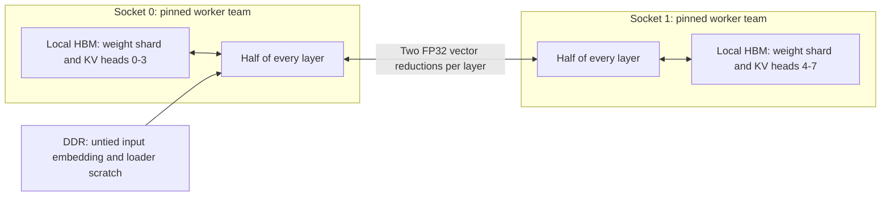

# Explicit NUMA placement and two-socket inference in llama3.x.c

Study date: 1 November 2026. Status: implementation design, based on source
inspection, existing measurements and primary documentation. This study does
not implement the backend or report a new inference benchmark.

## 1. Recommendation and scope

Build one model instance with two socket-owned shards. Place each shard's
frequently read weights and KV cache in that socket's HBM, and execute it with
a persistent team pinned to that socket. Partition every transformer layer by
attention-head groups and FFN intermediate channels. Combine the two partial
outputs after the attention output projection and after the FFN down projection.

The proposed first backend is **one Linux process, two persistent pthread teams,
anonymous explicitly bound memory, and shared-memory FP32 reductions**. It needs
the C library, system threading, libm and Linux interfaces, but no libnuma,
memkind, BLAS, MPI, oneDNN or collective-communication library. This is freedom
from third-party numerical/runtime dependencies, rather than portable ISO C.
The existing tokenizer's optional PCRE2 dependency is a separate concern.

Start with FP32 weights and FP32 KV to isolate placement and partitioning from
precision changes. Then validate existing Q8_0, followed by BF16 storage and
batched prefill as separate changes. BF16 is a proposed extension: the inspected
loader currently accepts FP32 and INT8 checkpoints only.



The target workload is single-request decode, with a path to batched decode and
prefill. Local full-model replicas are outside this design. Partitioning the
layers into two sequential halves remains a capacity/pipelining alternative,
but does not make both sockets process the same token simultaneously without
other independent work in flight.

## 2. Evidence and its limits

The inspected engine HEAD was `43b5d508bdd5293ebb06db1384578318551f4e61`;
the inspected hw-bench HEAD was `f4bfacbbf2533a776257c1de1f33fbf861f0aa2f`.
The study also reads working-tree documents and generated evidence, which are
not necessarily committed at those revisions. Source links below are relative
to these neighboring checkouts; the external references make the Linux and
parallelism reasoning independently reviewable.

The [historical read export](../../hw-bench/data/processed/bandwidth_search/historical_read.csv)
contains the following existing measurements. GB/s uses decimal bytes/second;
GiB uses 2^30 bytes.

| Read-stream configuration | Useful bandwidth | Total test pool | Evidence |
| --- | ---: | ---: | --- |
| One socket, local HBM | 534.2 GB/s | 8 GiB | `flat-udual-20261031T182202Z` |
| Two simultaneous socket-local HBM workers | 1103.9 GB/s | 16 GiB | same campaign |
| One socket, local DDR | 261.8 GB/s | 8 GiB | same campaign |
| Two simultaneous socket-local DDR workers | 523.5 GB/s | 16 GiB | same campaign |
| One process across two sockets, first-touch HBM placement | 1099.7 GB/s | 16 GiB | `flat-span-20261012T073217Z` |
| One process across two sockets, interleaved HBM placement | 265.0 GB/s | 16 GiB | same spanning campaign |

The 265 GB/s figure is HBM with a different placement/access relationship; it is
not a DDR measurement. The two-socket result is simultaneous aggregate streaming
bandwidth, not the speed of an inference engine. Neither result proves the same
rate at a nearly full HBM footprint or with the engine's matrix shapes.

At inspection, the [new search acceptance export](../../hw-bench/data/processed/bandwidth_search/acceptance.csv)
marked its selected campaign incomplete, and its ranking and launch exports
contained no results. Thus, this study claims neither a winning mixed HBM/DDR
core split nor a verified large-capacity bandwidth. The
[configuration study](../../hw-bench/docs/BANDWIDTH_CONFIGURATION_STUDY.md)
describes the pending evidence. No cluster access or new jobs were needed for
this document.

Flat mode exposes HBM and DDR as separately allocatable NUMA regions; using HBM
does not disable DDR. Cache mode does not expose the HBM cache as an ordinary
application allocation target. The proposed explicit backend requires verified
Flat-mode memory targets. [Intel memory modes](https://www.intel.com/content/www/us/en/developer/articles/technical/xeon-scalable-processor-max-series.html)

## 3. What the engine does today

| Source | Observed behavior | Consequence |
| --- | --- | --- |
| [runtime.c](../src/runtime.c), `checkpoint_map` | Validates dimensions/extents, then uses a read-only `MAP_PRIVATE` file mapping | Weight residency depends on file-page history; no explicit shard ownership |
| [runtime.c](../src/runtime.c), `memory_alloc` | `calloc` with an inline accounting header | No requested NUMA node, page-aligned region contract or allocation-backend tag |
| [run.c](../src/run.c) and [runq.c](../src/runq.c) | One global weight view and one RunState | Need explicit per-socket descriptors |
| Both RunState allocators | K/V are FP32, including with INT8 weights | Weight quantization does not halve KV memory |
| [runq.c](../src/runq.c), `memory_map_weights` | Expands the full token embedding table into FP32 | About 1.96 GiB extra for 8B; a useful DDR candidate |
| [kernels_simd.c](../src/kernels_simd.c), `parallel_rows` | Opens an OpenMP region and distributes a contiguous global row interval | Affinity alone does not describe tensor ownership |
| `f32_run` / `q8_run` | Concatenates Q, K and V row ranges before distribution | A global halfway split does not give each socket half of each projection |
| `k_attention` | Splits GQA groups by position chunks; globally schedules tasks dynamically | Reusable computation, but task queues and merges must become socket-local |
| [app.c](../src/app.c), `run_sequence` | Calls one-token forward repeatedly for prefill | Tensor parallelism alone does not produce batched GEMM prefill |
| [report.c](../src/report.c) | Reports mapped checkpoint size and allocator categories | Need owned weight bytes, placement and per-socket timing fields |

The current SIMD implementation has already addressed several earlier scalar
bottlenecks. Treat [hbm-roofline.md](hbm-roofline.md) as historical analysis;
its descriptions of scalar kernels and predicted speedups are not current
measurements of the newer SIMD backend. [kernels.md](kernels.md) describes the
inspected kernel implementation.

## 4. Topology: establish what “local HBM” actually means

CPU affinity, memory tier and socket locality are three separate properties.
Pinning a worker to socket 0 does not by itself select socket 0's HBM: normal
local allocation can choose the CPU-bearing DDR node. Likewise, a memory-only
NUMA node is not universally proof of HBM; other machines can expose other
memory technologies that way.

Implement discovery in C without invoking `numactl` or `lscpu`:

1. Enumerate online CPUs and read their `physical_package_id`, `core_id` and
   sibling lists under `/sys/devices/system/cpu/cpu*/topology/`.
2. Intersect them with the launching thread's allowed CPU affinity. Capture the
   job's full allowed CPU set before pinning that thread to a single core.
3. Enumerate online memory nodes, their CPU lists, memory sizes and distances
   under `/sys/devices/system/node/`.
4. Read allowed memory-node IDs, preferably using `get_mempolicy` with
   `MPOL_F_MEMS_ALLOWED`; `/proc/self/status` is an additional diagnostic.
5. Use firmware performance attributes and initiator/target relationships when
   available. Otherwise require an explicit user-provided socket-to-HBM/DDR map
   for the supported platform and verify it against discovered nodes. Do not
   silently classify an unfamiliar memory-only node as HBM.
6. Resolve one local HBM and one local DDR target per socket for the first
   supported topology. Reject an ambiguous SNC/multi-node mapping until that
   layout has an explicit implementation.

Firmware-reported bandwidth is a classification hint, not measured sustained
bandwidth. Linux exposes optional initiator relationships and performance
attributes in sysfs. [Linux NUMA performance interface](https://docs.kernel.org/admin-guide/mm/numaperf.html)
The allowed-memory query is described in
[get_mempolicy(2)](https://man7.org/linux/man-pages/man2/get_mempolicy.2.html).

Keep node numbers and CPU IDs in runtime configuration and reports, not constants
inside kernels. Confirm the running allocation permits both HBM nodes; access
to both CPU sockets alone does not establish this. Validate the map again for
each benchmark allocation, and invalidate the experiment if its allowed sets
change while running.

## 5. Explicit allocation and weight placement

### 5.1 Policy by data role

| Data | Proposed placement | Ownership |
| --- | --- | --- |
| Transformer linear weights, classifier and Q8 scales | Local HBM | One persistent shard per socket |
| K/V for local head groups | Local HBM initially | One cache shard per socket and request |
| Residual vector, Q, local attention/FFN outputs, partial sums | Local allocation per socket | Small duplicated residuals; intermediate values stay local |
| Norm weights and RoPE tables | Small local copies | Deliberate duplication, not full-model replication |
| Untied token embedding table | Explicit DDR allocation initially | One table; broadcast the selected row |
| Tokenizer, sampler, logs and tensor metadata | DDR/default memory | Coordinator-owned |
| Temporary loader buffers | Bounded explicit DDR allocations | Startup only |

An untied embedding lookup reads only one row per token, unlike the classifier,
which reads the entire output matrix. For tied embeddings, retain the shared
tensor as vocabulary-row HBM shards and fetch the selected embedding row from
its owner; do not also allocate an unnecessary full DDR copy. Existing INT8 can
eventually dequantize just that row instead of expanding the entire table.

### 5.2 Allocation contract

Introduce an owned-region descriptor, separate from the payload:

```c
/* Proposed interface and fields, not existing engine API. */
typedef struct {
    void *mapping_base;
    size_t mapping_bytes;
    void *data;
    size_t logical_bytes;
    int socket, node;
    int role, backend;
} NumaRegion;
```

For every large HBM region, use this order:

1. Check shape multiplications, offset arithmetic and page-size rounding for
   overflow. Compute per-socket budgets before allocating.
2. Reserve writable private anonymous memory with `mmap`. Do not use
   `MAP_POPULATE`, initialize an inline header, zero the payload or otherwise
   fault it before binding.
3. Apply a **single-node** `MPOL_BIND` policy to the region using
   `syscall(SYS_mbind, ...)`. The node bitmask must represent actual node IDs;
   size it using the possible-node range, including offline ID holes, and pass
   its node-ID bit capacity as `maxnode`, not the bitmask's byte size. The mask
   sets only the selected target node's bit.
4. Optionally request THP for large weight/KV arenas before population. This is
   a performance hint; normal-page placement remains valid if unavailable.
5. Have the owning socket team write/fill the region. A read of anonymous zero
   memory alone is not a sufficient population check. Weight loading itself can
   supply the writes; avoid a redundant full weight memset.
6. Verify residency after population and before timing. Make completed weight
   regions read-only with `mprotect` if convenient for detecting writes.
7. Free with the descriptor's allocation backend and original mapping extent.

New allocations do not need migration flags. Retrofitting a policy onto already
populated pages requires separate treatment; this design avoids that path.
Bind each socket independently: a mask containing both HBM nodes allows either
target and does not express shard ownership. The allocation order follows
[mbind(2)](https://man7.org/linux/man-pages/man2/mbind.2.html).

CPU-set restrictions and memory policy are independent; process/thread default
policy is also different from a policy on a specific mapping. Use per-region
policies for the engine's heterogeneous allocations, rather than changing a
thread default and assuming existing sibling workers inherit it.
[Linux memory-policy scopes](https://docs.kernel.org/admin-guide/mm/numa_memory_policy.html)

The raw Linux syscalls avoid the libnuma wrapper dependency. Include Linux UAPI
policy constants and the system `SYS_*` definitions rather than hardcoding
syscall numbers. Guard this backend on Linux and retain a portable default
backend. [syscall(2)](https://man7.org/linux/man-pages/man2/syscall.2.html)

Explicit HBM mode must fail clearly if binding is unavailable, denied, or its
targets are disallowed. Do not call a fallback DDR run “HBM.” A successful
virtual mapping does not guarantee later physical capacity: initialization must
populate and verify the requested working set before accepting a benchmark.
Allocation pressure can still terminate the process; do not promise recoverable
failure from every anonymous page fault.

Keep accounting updates in the initializing coordinator, or synchronize them:
the current `memory_current`/`memory_peak` counters are ordinary globals and
cannot safely be updated by simultaneous loader workers. Allocation and free
paths must handle partial startup and release every owned mapping exactly once.

### 5.3 Why the current file mapping is insufficient

The current read-only mapping uses page-cache pages. A file staged, validated or
used by another process may already have pages on DDR or the opposite socket.
Applying `mbind` to a read-only file view does not establish ownership of those
existing shared pages. A later CPU or memory binding is not evidence that they
moved. Kernel documentation distinguishes file-backed reads from anonymous/COW
pages. [File-page placement semantics](https://docs.kernel.org/admin-guide/mm/numa_memory_policy.html)

Use the checkpoint as an input source and copy its data into the explicitly
bound owned shards. A temporary source mapping is acceptable for loading if
inference does not continue to use it as its weight storage. Release that
mapping afterwards. Ordinary file I/O may retain page-cache memory separately;
account for startup/cached-file footprint rather than claiming copying eliminates
the page cache. Avoid forcing cache eviction or migrating shared file pages.

### 5.4 Loader and packing strategy

Preserve the checkpoint validation and on-disk ABI. Build validated tensor
descriptors containing file offsets, dimensions, dtype and scale offsets before
constructing shard views. This is a refactor of `checkpoint_map`, not removal of
its dimension, truncation, endian or metadata checks.

For output-row partitions, load the contiguous row range directly into the
destination shard. For input-column partitions, read bounded blocks of complete
source rows into DDR scratch, then pack the required column slice of every row
into the owner's contiguous HBM matrix. Batch I/O instead of issuing one tiny
read per slice. A parallel `pread` loader avoids shared file-offset state; it
must handle short reads, `EINTR` and unexpected EOF.
[pread(2)](https://man7.org/linux/man-pages/man2/pread.2.html)

Initially, favor simple bounded packing over simultaneous whole-model source
and packed HBM copies. Repacking may copy through remote scratch during startup;
this is acceptable when reported separately from inference. Later, a versioned
prepacked checkpoint can reduce startup time, but bind its final anonymous
destination as before. Record format, shard shape, source identity and packing
version; validate that packing only rearranges values and scales.

Q8_0 requires two arrays per tensor shard: quantized values and FP32 group scales.
Pack both. An input-column split must land on a group boundary; for the equal
split require `2048 % gs == 0` for Wo and `7168 % gs == 0` for W2. Check these
in addition to the original full-matrix divisibility checks. Reject or implement
another validated partition for incompatible group sizes; do not re-quantize a
boundary silently.

### 5.5 Page granularity, huge pages and verification

Use separate page-aligned allocations for sockets. Never bind different slices
of the same base page to different sockets. Arena suballocations may share pages
only when their node ownership and lifetime permit it. Keep allocation metadata
outside payload mappings so touching a header cannot pre-place a weight page.

For large arenas, compare normal pages with `MADV_HUGEPAGE`. Align arena starts
and shard boundaries suitably for the platform's THP size when doing so, without
crossing socket policies. Record actual huge-page backing from `smaps`; a
successful advice call is not proof of huge pages. Avoid mandatory hugetlb pools
as the initial backend because they introduce deployment requirements.
[Linux THP documentation](https://docs.kernel.org/admin-guide/mm/transhuge.html)

Query a deterministic spread of populated page addresses with
`syscall(SYS_move_pages, 0, count, addresses, NULL, status, 0)`. This requests
location, not migration. Inspect syscall failure and each page status; distinguish
unpopulated pages from wrong-node pages. For small tests, query every page;
for large regions, record the sampling scheme and do not claim full verification
from a sample. [move_pages(2)](https://man7.org/linux/man-pages/man2/move_pages.2.html)

Associate region addresses with `/proc/self/numa_maps` and `/proc/self/smaps` for
additional checks; VMAs can merge, so retain the engine's own extent manifest.
If page-query access is unavailable, record a less direct verification method or
mark placement unverified. Recheck populated KV pages after context growth and
at run completion. Weights have all been populated before warm-up; KV may reserve
more virtual capacity than it has used.

## 6. Model partition and exact forward computation

### 6.1 Concrete 8B dimensions

The [model configuration used by hw-bench](../../hw-bench/configs/theory.toml)
specifies 32 layers, hidden width 4096, FFN width 14336, 32 query heads,
8 KV heads, head width 128 and vocabulary size 128256, with untied embeddings.
Each KV head serves four query heads.

Use `W[out][in]`, matching the engine, throughout this document. This avoids
the ambiguous “row/column parallel” names used with transposed matrix conventions.

| Tensor | Full shape | Each socket's shape | Partition |
| --- | --- | --- | --- |
| Wq | 4096 x 4096 | 2048 x 4096 | Output rows; 16 complete query heads |
| Wk, Wv | 1024 x 4096 each | 512 x 4096 each | Output rows; 4 complete KV heads |
| Wo | 4096 x 4096 | 4096 x 2048 | Input columns corresponding to local query heads |
| W1, W3 | 14336 x 4096 each | 7168 x 4096 each | Output rows; matching intermediate channels |
| W2 | 4096 x 14336 | 4096 x 7168 | Input columns corresponding to local FFN channels |
| Classifier | 128256 x 4096 | 64128 x 4096 | Vocabulary/output rows |

Socket 0 owns KV heads 0–3 and query heads 0–15; socket 1 owns KV heads 4–7 and
query heads 16–31. Head ownership must preserve GQA grouping and the existing
within-head RoPE layout. The generic backend validates divisibility and matching
head/channel boundaries rather than assuming every supported model is 8B.

### 6.2 One layer on both sockets

Let `x_s` be each socket's identical local residual vector. On socket `s`:

```text
u_s       = RMSNorm(x_s)
q_s,k_s,v_s = local_QKV(u_s)
q_s,k_s   = RoPE(q_s,k_s,position)
append k_s,v_s to this socket's KV shard
a_s       = attention(q_s, local_K_history, local_V_history)
p_s       = Wo_s * a_s                         # full-width partial sum
x_s       = x_s + (p_0 + p_1)                  # exchange/reduction 1
u_s       = RMSNorm(x_s)
h_s       = SiLU(W1_s*u_s) * (W3_s*u_s)        # local 7168-vector
r_s       = W2_s * h_s                        # full-width partial sum
x_s       = x_s + (r_0 + r_1)                  # exchange/reduction 2
```

Apply the residual **once after combining partial contributions**. Calling the
existing residual-add kernel independently on both sockets and then summing
those outputs would add the residual twice. New projection drivers must expose
partial-output storage without this fused residual epilogue.

Only the partial projection vectors cross sockets within a layer. Historical
K/V, attention scores and FFN intermediate vectors stay with their owner. Both
sockets can compute small norms locally from identical residuals. This applies
the established paired-projection/head partition to this engine's dimensions;
the underlying pattern is described in
[Megatron-LM, section 3](https://arxiv.org/html/1909.08053v4#S3).

For W8A8, preserve the current activation quantization groups: QKV and W1/W3
quantize the identical full normalized input locally; Wo and W2 quantize only
the owned input slice, with boundaries aligned to the original groups. For
W8A32 there is no activation quantization. Splitting FP32 dot products changes
summation order, so compare within tolerance rather than requiring bit identity.
Keep reduction inputs/results in FP32 even when weight or KV storage is BF16.

### 6.3 Embedding, classifier and sampling

The coordinator fetches/dequantizes the selected embedding row and publishes it
to both local residual buffers. After the final norm, both sockets compute their
vocabulary logits from local classifier rows. The first implementation should
gather logits to the existing sampler, sample once, then broadcast the token ID.
Do not give each socket an independent sampler/RNG stream.

The full FP32 logit vector is 513024 bytes; a coordinator already holding its
local half needs to receive approximately half that vector. Keep the classifier
in HBM even when the untied input embedding is in DDR. For future prefill, avoid
materializing/gathering logits at prompt positions where the API does not need
them; retain a diagnostic path for reference comparisons. Distributed top-k or
top-p is optional future work and must preserve the sampler's semantics.

### 6.4 A useful competing implementation

The earlier roofline document proposes splitting **every** matrix by output rows,
including Wo and W2. That is a valid alternative: each socket stores local weight
rows, but it must obtain the full attention/FFN input vector before those output
projections, and exchange output slices when the next operation needs a full
residual. The existing full-row dot kernels can be reused more directly.

The paired partition above retains head/FFN intermediates locally and uses two
FP32 sums per layer, but requires input-slice packing and partial-dot kernels.
On a shared-memory CPU, both designs exchange relatively small vectors and
neither is proven faster here. Use the all-output-row design as an optional
lower-complexity comparator, with the same explicit placement, head-local KV and
thread affinity. The recommendation is to target paired tensor parallelism;
do not present it as a measured winner over the all-row alternative.

## 7. KV storage, attention work and DDR expansion

Use separate socket allocations, logically:

```text
K[socket][request][layer][capacity][local_kv_head][128]
V[socket][request][layer][capacity][local_kv_head][128]
```

For the first contiguous implementation, each socket's KV width is 512 rather
than 1024. Pass the local head counts and local stride to attention; a global
head ID used as a local array index is an out-of-bounds bug. RoPE position and
request position must be identical across sockets.

Do not store half-head slices in alternating portions of a shared token row.
For BF16, a full K row is only 2048 bytes and each socket's half is 1024 bytes;
multiple ownership regions would fit within one ordinary 4 KiB page. Separate
arenas eliminate that conflict. Position chunks within a socket can share that
socket's pages safely.

Retain the existing grouped attention and numerically stable chunk merge, but
schedule `(local KV group, position chunk)` tasks only inside the owning team.
Four local KV heads need not limit execution to four threads: position chunks
supply additional tasks. At very short contexts there may still be too little
attention work to occupy all cores. Adapt chunk count using the local team size,
and measure scheduling overhead. The current kernel writes a score buffer;
include those reads/writes in overhead rather than claiming a pure one-pass KV
stream.

For future multi-request operation, give both socket halves of a request the
same capacity/position metadata and perform admission against **both** budgets.
A shared batch schedule must preserve token order and prevent one socket from
advancing a request independently. Multiple requests and batched GEMM are not
implemented by the present one-token forward API.

When HBM capacity becomes a constraint, add fixed-size KV blocks allocated from
an explicitly selected local tier. A block table can route each local head's
position chunks to HBM or DDR without moving heads across sockets. A simple
initial policy reserves HBM blocks first and allocates excess blocks in local
DDR. Allocate a block before writing new tokens and report the tier transition.
Avoid per-token whole-cache reallocations or migrations in the measured path.

Dense full attention still reads old tokens: old DDR blocks are slower active
data, not an unused cold tier. Selective retention, sliding windows and dropped
tokens alter model behavior unless explicitly supported by the architecture.
Exact tiered attention can reuse the stable merge of chunk maxima, exponential
sums and value accumulators across HBM/DDR chunks. Preserve one global softmax
normalization per query head. Do not normalize each tier and add the resulting
attention outputs without the appropriate rescaling.

## 8. Capacity and bandwidth models

### 8.1 Capacity is different from bytes read per token

Derived from the dimensions above:

```text
Transformer matrix parameters = 32 * (2*4096^2 + 2*4096*1024
                                      + 3*4096*14336)
                              = 6979321856
One embedding/classifier      = 128256*4096 = 525336576
Norm parameters               = (2*32+1)*4096 = 266240
Total model parameters        = 8030261248
Frequently streamed matrices  = transformer matrices + classifier
                              = 7504658432 parameters
```

The untied input embedding occupies capacity but only one row is read per token.
The following proposed HBM allocations keep it in DDR, duplicate FP32 norms on
the two sockets, and omit padding, scratch and KV:

| Weight storage | HBM matrices + norms per socket | Complete model storage, one copy, before extra runtime copies |
| --- | ---: | ---: |
| FP32 | 13.980 GiB | 29.915 GiB |
| BF16 matrices, FP32 norms | 6.990 GiB | 14.958 GiB |
| Q8_0, group size 64, FP32 scales/norms | 3.714 GiB | 7.947 GiB |

Q8_0 at group size 64 uses `1 + 4/64 = 1.0625` bytes per matrix parameter, not
exactly one byte. The existing expanded FP32 embedding adds another 1.957 GiB;
in the proposed design it is in DDR or replaced by row-wise dequantization.
For tied models, recalculate using the shared tensor rather than this untied
8B accounting. BF16 values here are storage arithmetic, not loader support.

### 8.2 KV memory

Let `T_total` be the sum of retained token counts across active requests, `b_kv`
the stored bytes per K/V element, and assume balanced four-head ownership:

```text
KV_total_bytes      = 2 * 32 * T_total * 8 * 128 * b_kv
KV_per_socket_bytes = KV_total_bytes / 2
```

| Requests x retained tokens | Total BF16 KV | Total FP32 KV |
| --- | ---: | ---: |
| 1 x 8192 | 1 GiB | 2 GiB |
| 8 x 8192 | 8 GiB | 16 GiB |
| 8 x 32768 | 32 GiB | 64 GiB |
| 1 x 131072 | 16 GiB | 32 GiB |
| 8 x 131072 | 128 GiB | 256 GiB |

For one 128K request with FP32 weights/KV, each socket needs approximately
`13.980 + 16 = 29.980 GiB` before scratch/reservations. With BF16 weights/KV it
needs approximately `6.990 + 8 = 14.990 GiB`. Both are plausible HBM-resident
capacity cases, not a latency claim. Eight 128K requests exceed node HBM capacity
even with BF16 KV before accounting for weights.

Contiguous caches reserved and fully populated to a maximum length consume that
capacity even before all positions are used. Block allocation can instead track
active tokens plus block rounding. Report reserved virtual, committed/resident
and logical active KV bytes separately.

For each socket independently enforce:

```text
weights_s + KV_s + workspaces_s + communication_s + padding_s
    <= allowed_HBM_budget_s
```

Choose the allowed budget from the allocation's available memory and an explicit
reserve, rather than using nominal installed capacity as guaranteed free space.
A 56 GiB/socket planning cap leaves 8 GiB below nominal 64 GiB, but is an
illustrative reservation policy, not evidence that 56 GiB is free. Future tiled
prefill may require substantially different workspaces from decode.

### 8.3 Traffic and expected scaling

For single-token decode, two reductions of 4096 FP32 elements per layer give:

```text
32 layers * 2 reductions * 4096 * 4 bytes = 1 MiB logical vector sizes/token
```

In a symmetric implementation where each socket reads the peer's full partial
vector once, this is about **2 MiB of payload across both directions** per token,
before coherence/protocol overhead, embedding/logit transfer and synchronization.
This is not 1 MiB of measured UPI traffic. There are 64 reduction phases; local
kernel completion barriers and buffer acknowledgments are additional events.

At a prefill microbatch of `M` tokens, these vectors become `M x 4096` and their
payload scales with M. A single-token communication estimate cannot be applied
unchanged to large batched prefill.

An intentionally optimistic weight-stream model uses frequently streamed matrix
bytes only, no embedding-table scan, KV, compute, conversion or synchronization:

| Weights | One socket at 534.2 GB/s | Two sockets at 1103.9 GB/s |
| --- | ---: | ---: |
| FP32 | 56.19 ms/token | 27.19 ms/token |
| BF16 | 28.09 ms/token | 13.60 ms/token |
| Q8_0, group size 64 | 14.93 ms/token | 7.22 ms/token |

These are modeled times, not achievable latency promises. The stream baselines
come from different active-socket configurations, so even their ratio slightly
above two is not a general scaling law. Actual layer time is closer to:

```text
sum_over_layers(max(socket_0_local_time, socket_1_local_time)
                + exposed_exchange_and_sync_time)
+ embedding + classifier/sampling + other_serial_work
```

Measure local GEMV rate and attention time rather than substituting the stream
ceiling. Q8 conversion/integer work can limit kernels; BF16 storage needs its own
load/compute path. At long context, reading the active KV once is already a large
traffic term, and GQA reuse, cache behavior and score buffers affect actual bytes.

If a local operation must serially stream `H` bytes from HBM and `D` bytes from
DDR, its transfer model is `H/B_HBM + D/B_DDR`, not `(H+D)/(B_HBM+B_DDR)`.
Concurrent tier workers can overlap transfers, but share cores and memory-system
resources and must be timed together. For simultaneously processed shards with
fractions `f_s` and sustained rates `B_s`, completion is bounded by
`min(B_s/f_s)`, not just their sum when shards are imbalanced.

## 9. Persistent scheduling and shared-memory reduction

Create a fixed total worker count within the job's allowed CPUs. Socket leaders
are members of their local teams, not extra full-core spinning threads. Pin each
worker to its chosen physical core and read back its affinity. Start with one
thread per physical core; measure smaller teams. Linux affinity is constrained
by allowed CPUs and errors must be checked.
[pthread_setaffinity_np(3)](https://man7.org/linux/man-pages/man3/pthread_setaffinity_np.3.html)

Refactor numerical row-range helpers so the teams invoke local work directly.
Calling the existing OpenMP-wrapped public GEMV from each pthread leader risks
nested/global teams and oversubscription. Select one scheduling backend at a
time. The pthread backend can use `OPENMP=0` and `-pthread`, while retaining the
current scalar/OpenMP reference path for comparisons.

Give each socket its own job state, local barrier and attention task queue.
Publish phase descriptors with release/acquire synchronization. Keep worker
counters and peer notification flags on separately aligned cache lines. Never
use `volatile` as a replacement for C atomic synchronization.

A safe first reduction protocol is:

1. Workers finish writing the local partial vector, then meet a local barrier.
2. Each leader publishes that the socket's partial is ready for generation g.
3. After observing peer readiness with acquire semantics, local workers read
   disjoint portions of both partial vectors and add `p_0 + p_1` once to their
   own local residual. Use a consistent operand order on both sockets.
4. After all local readers finish, publish a consumed acknowledgment for g.
5. Do not overwrite a published partial buffer until the peer has acknowledged
   consuming it. Generation-tagged double buffering is optional, not a substitute
   for this lifetime rule.

Do not let all 56 workers fetch the entire peer vector; divide its elements among
them. The two partial arrays are immutable while peers consume them. Local
residuals and caches have one socket owner. This avoids data races, false sharing
and cross-socket write contention on a common residual array.

Begin with straightforward barriers/acknowledgments. Only optimize spinning,
futex parking or overlap after measuring per-phase cost. A small INT8 model may
spend more time synchronizing than it saves in weight reads. Equal shards are a
good initial choice; asymmetric core counts or shards need measured evidence
and must respect complete head groups and quantization boundaries.

## 10. Validation and experiment plan

The following are required experiments after implementation, not completed runs.
Compute-intensive validation belongs in allocated compute resources. No new
cluster jobs, scheduler changes, global memory-policy changes or page-cache
evictions are part of this documentation work.

Future two-socket scaling measurements should use an exclusive whole-node
allocation where available, with the same allocation policy for comparisons.
Record any resource sharing rather than attributing its variability to the
partition. Keep those experiments separate from unrelated inference jobs.

### 10.1 Numerical and concurrency validation

- Reconstruct tiny original tensors from shards, checking every value and Q8
  scale. Test both output-row copies and input-slice repacking.
- Compare each reconstructed projection and complete forward logits with the
  existing one-socket FP32/Q8 references. Include residual application, GQA
  mapping, RoPE positions, tied/untied classifier and incompatible group sizes.
- Choose and record absolute/relative error tolerances from the existing
  reference tests and observed accumulation error. Do not use sampled text alone
  as correctness evidence; small logit differences can change generation.
- Exercise position/chunk boundaries, cache reset, context limit, long contexts,
  uneven local thread counts and multiple requests once supported.
- Stress reduction generation counters and buffer lifetimes with injected worker
  delays. Check local/peer phase agreement and use a thread sanitizer where the
  chosen backend/toolchain supports it.
- Validate BF16 KV independently against FP32 KV before combining that numerical
  change with tiering or batched execution.

### 10.2 Placement acceptance

For strict placement tests, all successfully queried populated pages must match
the region's requested node; classify any mismatch or unknown status explicitly.
Check policy and observed residency separately. Fully enumerate pages in small
tests; for production-sized samples report coverage instead of claiming certainty
about unqueried pages. Verify every worker's affinity and the mapping's huge-page
state. Fail or label unverified configurations rather than silently including
them as local-HBM results.

### 10.3 Controlled performance matrix

| Experiment | Purpose |
| --- | --- |
| Current file mapping + fixed affinity | Existing-loader baseline with observed residency |
| One socket, anonymous local DDR weights/KV | Separates loader changes from HBM benefit |
| One socket, anonymous local HBM weights/KV | Establishes the engine's local-HBM kernel rate |
| Two sockets, head/FFN TP, local HBM weights/KV | Tests the combined design against the optimized one-socket baseline |
| Two sockets, all-output-row partition, local HBM | Optional comparator for packing/reduction tradeoffs |
| Normal pages versus verified THP | Isolates page-size effects |
| HBM weights + HBM/DDR KV blocks | Measures capacity expansion and its latency cost |
| Remote weight target in a controlled microbenchmark | Checks locality diagnostics and remote penalty; not a deployment choice |

Use 14, 28, 42 and 56 workers/socket where allowed; narrow the grid after the
local scaling curve. Test actual available models at the engine's FP32 and Q8
formats before adding BF16. Use retained contexts of 512, 8192 and 32768 tokens,
then 131072 only for models configured for that length and validated capacity.
Hold output count, sampling mode and workload constant. Multi-request batch sizes
1, 4 and 8 are future cases after request scheduling exists, not flags the current
engine already supports.

Measure startup, pack/load, population/verification, prefill, time to first token,
steady decode and sampling separately. Warm up both socket teams and start timed
work at a common barrier. Use at least three independent launches and report
launch medians and full observed ranges; repeat/fine-tune when ranges overlap.
Long-context decode measurements should start at comparable retained contexts,
not average together a short empty-cache run and a long full-cache run.

Keep a single host monotonic time domain and avoid adding independently measured
socket rates. Record local QKV/Wo/FFN/attention times, barrier wait, reduction
cost, per-socket imbalance, page faults and clock/power conditions. Optional
external performance tools can count controller bytes and UPI activity without
becoming engine dependencies. Count node-wide counters once, not once per team.

Recommended report extensions include the topology snapshot, effective CPU and
memory masks, per-region role/node/bytes, packed weight bytes, loader scratch
peak, KV storage dtype, reserved/resident/active KV bytes, placement query results,
actual THP backing and backend/partition identity. Retain checkpoint file bytes
separately from owned weight bytes and peak RSS. Do not infer low remote traffic
from page placement alone: task ownership and actual access patterns also matter.

### 10.4 Decision criteria

Accept the two-socket backend as a performance improvement only when it improves
the intended request latency or useful throughput over the optimized one-socket
baseline beyond run variability, with numerical and placement validation passing.
Report the crossover by precision, model size and context. A capacity increase
without a latency improvement is still useful, but is a different result.

Revisit the design if reductions dominate, a socket regularly waits for its
peer, attention generates remote cache reads, or larger working sets lose the
small-pool stream rate. Large compute-bound prefill requires separate GEMM
tiling and communication analysis; it does not inherit decode's scaling result.

## 11. Implementation sequence and code boundaries

| Step | Proposed changes | Completion evidence |
| --- | --- | --- |
| 1. Allocation/placement foundation | Linux topology/region helpers; extend allocator accounting with owned weights; preserve fallback backend | Bound anonymous buffers, known-node page queries, failure paths and one-socket DDR/HBM comparison |
| 2. Shard loader | Validated tensor manifest, row copy, input-slice packing, scale packing and ownership descriptors | Reconstructed tensors match; bounded startup memory; final weight residency verified |
| 3. Persistent teams | pthread worker pool and local range kernels; remove nested OpenMP from this path | One-socket numerical parity and no scheduling regression/oversubscription |
| 4. Two-socket FP32 | Head/FFN shards, separate local KV, two reductions, classifier gather, single sampler | Logit agreement, race/lifetime checks, measured scaling and synchronization breakdown |
| 5. Existing Q8_0 | Group-aligned W8A8/W8A32 partitions, identical scale semantics | Q8 reference agreement and separate speed/error results |
| 6. Storage precision | BF16 weight/checkpoint extension and BF16 KV, independently selectable | Converter/loader checks, numerical error characterization and footprint measurements |
| 7. Capacity/workload expansion | Blocked KV tiering, request scheduler and batched prefill | Exact tiered attention, admission accounting and workload-specific crossover measurements |

Suggested new modules are `src/numa.c` for discovery/bound regions,
`src/workers.c` for persistent teams and synchronization, and `src/shards.c` for
validated packing/ownership. These names and APIs are proposals. `runtime.c`
retains checked validation and shared accounting; `run.c`/`runq.c` retain the
forward order; kernel range helpers perform computation without starting teams;
`report.c` exposes evidence. Avoid introducing a broad distributed framework for
the first fixed two-socket backend.

The principal remaining uncertainty is performance, not whether this partition
can express the forward computation. The existing evidence supports socket-local
HBM ownership. The engine experiments must establish whether its local kernels,
attention scheduling and shared-memory exchanges can turn that ownership into
lower latency for one distributed model.
