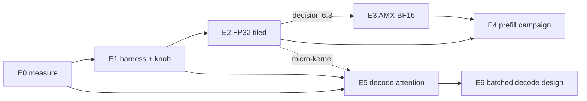

# Track E: faster attention, then the post-M5 follow-ups

Plan date: 18 November 2026. Status (18 November 2026): **E0 and E1 code merged into `develop` (397aa10) and passing `make test`; cluster job 5860637 (`STAGE=check PHASE="E0 E1"`) submitted.** Baseline: `develop` at `1dc674c` (M5 closed, D2 results in
[`docs/numa-tp-prefill-results.md`](../../numa-tp-prefill-results.md)). Source brief:
[`agent-brief.md`](agent-brief.md); this document turns it into phases with a correctness gate, a value gate and a
go/no-go decision at the end of each one. Read §1-§5 once, then the phase you are working on.

Every number is labelled **measured**, **modeled** or **estimated** as in [`docs/hbm-roofline.md`](../../hbm-roofline.md).
Numbers derived here from measured inputs say how (they are **estimated** unless the derivation is pure arithmetic on
measured values, in which case they are marked **derived**).

## 1. How to use this document

- Phases run in order **E0 → E1 → E2 → (E3) → E4 → E5 → E6**. E3 is conditional on the E2 decision (§6.3). E6 is a design
  phase only. Items with a low expected gain are deferred with an explicit trigger (§9), so they are not forgotten.
- A phase is **closed** only when all three of its gates are met and written down with the observed value next to each:
  1. **Correctness gate**: tests and engine comparisons (§5.3).
  2. **Value gate**: the measured gain that justifies keeping the change, with the threshold fixed *before* the run.
  3. **Decision**: what the result means for the next phase (proceed, change course, stop). Recorded in the phase's
     results section and in the status table (§4).
- If a value gate is missed, the change stays opt-in (or is reverted from the default path), the miss is recorded with its
  cause, and the decision table of that phase says what happens next. A missed value gate is a result, not a failure to hide.
- One branch per phase (`feature/attn-eN-<slug>`), conventional commits, merge into `develop` when the phase's gates pass.

## 2. Starting point

### 2.1 Measured facts this plan builds on

| Fact | Value | Source |
| --- | --- | --- |
| 8B AMX-BF16 prefill, one socket, 2048 tokens | 639.7 tok/s, TTFT 3.32 s, attention 41% of the forward | measured, C7 ([`batched-prefill.md`](../../batched-prefill.md)) |
| 8B AMX-BF16 prefill, one socket, 8192 tokens | 269.9 tok/s, TTFT 30.6 s, attention 74% (about 23 s) | measured, C7 |
| 8B AVX-512 FP32 prefill, 8192 tokens | 132.1 tok/s, attention 38% | measured, C7 |
| 1B AMX-BF16 prefill, 8192 tokens | 1176 tok/s, attention 78% | measured, C7 |
| Two sockets, 8B prefill at 8192 | 2.05-2.15x one socket | measured, D2 |
| 1B decode at 32768 context, two sockets | FP32 70.2 tok/s (attention 9.25 ms of a 14.1 ms token per socket); W8A8 78.7 tok/s, attention 81%, gain 1.26x | measured, B7 ([`tensor-parallel.md`](../../tensor-parallel.md)) |
| 8B W8A8 decode at 32768 | one socket 15.59 tok/s; two sockets 29.56 tok/s, attention 23.0 of 33.6 ms per socket (68%) | measured, B7 |
| Per-socket machine ceilings | HBM read 552 GB/s; AVX-512 FP32 FMA 8.8 TFLOP/s; AMX-BF16 112 TFLOP/s | measured, roofline §1 |

### 2.2 What these numbers imply (the arithmetic the gates use)

- **Prefill attention work**, 8B, 8192 tokens: `2 · n² · dim · layers` = 2 · 8192² · 4096 · 32 ≈ **17.6 TFLOP**
  (**derived**). In about 23 s that is **0.77 TFLOP/s**, i.e. **9% of the FP32 FMA peak** and under 1% of the AMX-BF16
  peak (**derived**). The current kernel is far from any compute ceiling, so even an FP32 kernel has room.
- **Value thresholds for 8192 tokens** (one socket, AMX-BF16 GEMMs, non-attention time about 7.6 s held fixed, **derived**):

  | End-to-end target | TTFT | Attention must take at most | Attention speedup needed |
  | --- | ---: | ---: | ---: |
  | 1.5x (the brief's "done when") | 20.4 s (about 400 tok/s) | 12.8 s | **1.8x** |
  | 2.0x | 15.3 s (about 535 tok/s) | 7.7 s | **3.0x** |
  | Upper bound, attention free | 7.6 s (about 1080 tok/s) | 0 | - |

  At 2048 tokens attention is about 1.31 s of 3.20 s (**derived**); a 1.8x attention speedup there gives about 1.23x.
- **K/V traffic of the current batched kernel** (**estimated**): a `(KV group, chunk, block of 4 rows)` task streams the
  row prefix of its group once per block of 4 rows. For 8B, 8192 tokens, M = 256: about 64 GiB per layer, **about 2 TiB per
  prompt**, i.e. about 8 FLOP per byte streamed into L2, and about 95 GB/s averaged over 23 s. Neither the HBM nor the L3
  ceiling explains 23 s; the instruction mix and L2→L1 traffic are the suspects (§6.1, hypotheses H1-H3).
- **Decode attention is not at the bandwidth ceiling** (**estimated** from measured B7 profile times, two sockets, each
  socket reading its half of the FP32 K/V): 1B FP32 at 32768 reads about 1.07 GB per socket per token in 9.25 ms, **about
  116 GB/s = 21% of 552 GB/s**; 1B W8A8 about 1.07 GB in 10.4 ms (about 104 GB/s, 19%); 8B W8A8 about 4.3 GB in 23.0 ms
  (**about 187 GB/s, 34%**). The brief calls decode attention bandwidth-bound;
  the data say it is not *yet*, and E0 must establish what bounds it before E5 picks a fix. BF16 KV (halving the bytes)
  only pays once the kernel actually runs at the bandwidth limit.

### 2.3 What the code does today

| Code | Location | Note |
| --- | --- | --- |
| Single-row split-K attention | `src/kernels_simd.c:1437` (`k_attention`) | (KV group, chunk) tasks; decode path |
| Chunk kernel, AVX-512 | `src/kernels_simd.c:510` (`attention_chunk_avx512`) | per head: 4 positions at a time, one `_mm512_reduce_add_ps` and one division per score, scores stored, then max, exp, PV with a broadcast per position |
| Chunk plan | `src/kernels_simd.c:1241` (`attention_chunks`), `:1252` | enough chunks for the team, each 32-256 positions; **depends on the row's position**, so neighbouring rows have different chunk boundaries |
| Split-K merge | `src/kernels_simd.c:1383` (`merge_chunks`) | partial slot `[acc(head_dim), max, sum]` per (row, head, chunk) |
| Batched causal attention (C3) | `src/kernels_simd.c:1488-1660` | `BATCH_ROW_BLOCK = 4` (`:1525`), `batch_task` (`:1547`), `attention_batch_driver` (`:1581`), waves bounded by `LLAMA_ATTN_WORKSPACE_MIB` (`:1261`) |
| ISA selection | `src/kernels_simd.c:64` | `LLAMA_KERNELS=amx` runs every non-GEMM kernel, attention included, on the AVX-512 path |
| Prefill callers | `src/run.c:341`, `src/runq.c:339`, `src/tp.c:638` (local heads) | all through `k_attention_batch` |
| Decode callers | `src/run.c:300`, `src/runq.c:398`, `src/tp.c:416`, `:483` | all through `k_attention` |
| Tests | `tests/kernels.c:236` (`test_attention`), `:291` (`test_attention_batch`), `tests/prefill.c` | per-row double reference (2e-5), batched bitwise vs per-row, causality by perturbation |
| Per-socket budget | `src/tp.c:892` (`check_budget`), `:781` (`tp_choose_batch`) | must count any new K/V copy |
| Gates | `scripts/lib/cresco8-common.sh:322` (`W8A8_GATE`), `:329` (`BF16_GATE`) | fixed, do not loosen without data |
| Uncore counters | `scripts/lib/cresco8-common.sh:107-114` | `perf stat --per-socket`, recorded as `perf_uncore` |

## 3. Scope: what this track does and why

The brief lists eight items. They are not equally valuable; this track orders them by **expected gain per unit of work** and
by **what each one unblocks**.

| Brief item | Expected value | Cost | Placement in this plan |
| --- | --- | --- | --- |
| 1. Faster prefill attention | high: up to about 4x TTFT at 8192 (upper bound, §2.2); 74-78% of long-prompt time | medium-high | **E0-E4** |
| 1b. Decode attention (brief §2.6) | high at long context: 65-81% of a 1B token at 32768 | medium | **E5** |
| 2a. Two-socket prefill gain above 2x | knowledge, and protects the E4 comparison | low | counters in **E0**, conclusion in **E4** |
| 2b. Two-socket W8A8 stop token after 29 tokens | correctness confidence; becomes a gate for every later phase | low | **E1** |
| 3. Batched decode / multi-request | the only throughput item; large | very high | **E6, design only**, implementation is a separate plan |
| 4. Exchange/compute overlap | small (reductions + waits at most 0.022 ms per token, B7) | medium | deferred, trigger in §9 |
| 5. Asymmetric FFN shards | unknown until imbalance is measured | medium | deferred, trigger in §9 |
| 6. BF16 checkpoints / BF16 KV / KV tiering | needs owner decisions; BF16 KV is evaluated inside E5 only as a measured option | high | owner decision, §9 |
| 7. K3 housekeeping | none (nothing depends on it) | low | deferred, §9 |

## 4. Phase overview

| ID | Phase | Depends on | Branch | Cluster run | Value gate (short) | Status |
| --- | --- | --- | --- | --- | --- | --- |
| E0 | [Measure attention](#e0-measure-attention-before-changing-it) | - | `feature/attn-e0-bench` | 1 bench job | bench reproduces the engine's attention time within ±20%; bound identified | done, cross-check failed (0.77): see [attention-profile.md](../../attention-profile.md); job 5860637 |
| E1 | [Harness, knob and determinism gate](#e1-validation-harness-knob-and-determinism-gate) | E0 | `feature/attn-e1-harness` | 1 check job | mutations caught; defaults bitwise unchanged; 2b explained | done: defaults bitwise, FP32 gate 8/8 identical, 2b = noise floor (margin 0.046 < 0.2); 13/13 mutations caught; job 5863571 |
| E2 | [FP32 tiled fused attention](#e2-fp32-register-tiled-fused-attention) | E1 | `feature/attn-e2-tiled` | check + bench | kernel ≥ 1.8x at 8B/8192, 2048 not slower | done: kernel 1.90x, 8B BF16 TTFT at 8192 1.66x, 2048 faster, check 18/18; see [attention-results.md](../../attention-results.md); jobs 5863571, 5864099; E3 decision pending owner |
| E3 | [AMX-BF16 flash attention](#e3-amx-bf16-flash-attention-conditional) | E2 decision | `feature/attn-e3-amx` | check + bench | ≥ 1.3x over E2 kernel; BF16 gate and ΔNLL | postponed (owner, 2026-11-18): see E2.8 outcome; revisit after E4 if ~2x at 8192 is wanted |
| E4 | [Prefill campaign and decision](#e4-prefill-attention-campaign-and-decision) | E2 (and E3) | `feature/attn-e4-campaign` | 1 campaign | ≥ 1.5x TTFT at 8192, one socket; two sockets agree | done: bench job 5864134 (commit 5a354ea) value gate PASS, 8B AMX-BF16 8192 one socket 16.18 s against 25.06 s split (1.55x; 1.89x vs C7 30.6 s, derived), 2048 faster in 16 of 16, decode ratio 0.997, placement 256 of 256, two-socket gain 2.13x → 1.95x; check job 5864123 30/30 logit gates PASS; the 12 generation comparisons (rerun 5864239 after the b318378 script fix) identical; `LLAMA_ATTN` row in D2 table; default switched to `tiled` by the owner (2026-11-19); see [attention-results.md](../../attention-results.md) §2 |
| E5 | [Decode attention](#e5-decode-attention) | E0, E1 (E2 micro-kernel) | `feature/attn-e5-decode` | check + B7 subset | ≥ 1.3x decode at 32768 on 1B; 512 not slower | run, value gates missed: check job 5864135 25 of 25 PASS; bench job 5870935 (commit 9d3f72b, 192 reports) `group` faster beyond variability in 16 of 16 cells at 8192 and 32768, but 1B 32768 one socket 1.075x (FP32) and 1.103x (W8A8) against ≥ 1.3x, 1B W8A8 two-socket gain 1.25x → 1.46x against ≥ 1.5x, 512: 2 of 8 cells below B7 (8B one socket); attention at most 51% of 552 GB/s, not bandwidth-bound, next limit the K/V access pattern (candidate 3); decode default stays `split` (owner); follow-ups (commit 961af17, jobs 5876098, 5876099, 5876113): 8B 512 one socket with 9 repeats, `group` 0.953x `split` on FP32 (fails, loss in the weight phases, cause not identified) and 1.002x on W8A8 (passes by the overlap rule), so the 512 gate now fails in 1 cell; 8B 8192 `group` 1.026x (FP32) and 1.065x (W8A8), 9 of 9 paired wins; K/V head-major layout probe (`attention-bench --kv-layout head`, microbenchmark only) 1.49-2.86x at 8192 and 32768 in 32 of 32 cells, two launch orders, so an opt-in engine head-major KV cache is recommended, not implemented; see [decode-attention-results.md](../../decode-attention-results.md) §8 |
| E6 | [Batched decode design](#e6-batched-decode-design-design-only) | E5 | `feature/decode-e6-design` | none | modeled ≥ 2x aggregate tok/s; owner go/no-go | done, gate failed on latency: experiment job 5875687 (commit 6a8586e, the second Flat node; 29 of 29 PASS, node cross-checks within 1% on 8B) and the step-time model `tools/e6_model.py`; 8B W8A8 at 2048 tokens, N = 8: aggregate 2.05-2.94x (throughput half met) but per-request latency 2.72-3.90x single against ≤ 1.5x in 8 of 8 configurations; latency stays ≤ 1.5x only up to N = 2 (AVX-512) or N = 3 (AMX-INT8); weights read once confirmed (decode GEMMs at M = 8 cost 1.24-1.30x M = 1, VNNI Q8 2.44x); two independent one-socket processes match batched two-socket TP at N = 8; D-E3 open (owner); see [E6-batched-decode-design.md](E6-batched-decode-design.md) |



E5 can start after E2 if E3 is skipped, or in parallel with E3 locally; cluster jobs still run one at a time (exclusive
node).

## 5. Shared rules for every phase

### 5.1 Knobs (env style, recorded in the report)

| Knob | Values | Phase | Default stays |
| --- | --- | --- | --- |
| `LLAMA_ATTN` | `split` (today's C3 kernel) \| `tiled` (E2) \| `amx` (E3; needs `LLAMA_KERNELS=amx`) | E1, E2, E3 | `split` |
| `LLAMA_ATTN_DECODE` | `split` (today) \| `group` (E5) | E5 | `split` |
| `LLAMA_ATTN_ROW_BLOCK` | `4` \| 1-16; diagnostic only, rows of a block are computed independently so results stay bitwise | E0 | `4` |
| `LLAMA_ATTN_KV` | `fp32` \| `bf16-shadow` (E3, prompt only) | E3 | `fp32` |

Separate prefill and decode knobs keep "decode unchanged" checkable: a prefill kernel can never change the decode path.
Defaults change only through a decision table that the owner signs off (§10).

### 5.2 Records

- Each phase updates its status line in §4 and writes its results section in this file (short) and, for cluster phases, a
  results document plus a `-validation` companion (date, node, compiler, job id, commit, campaign directory), following
  [`docs/batched-prefill.md`](../../batched-prefill.md) and its validation record.
- Results documents of this track: `docs/attention-profile.md` (E0), `docs/attention-results.md` (E2-E4),
  `docs/decode-attention-results.md` (E5), `docs/plans/E-followups/E6-batched-decode-design.md` (E6).
- Three repeats per headline configuration; report medians and full ranges. A gain counts only if the ranges do not overlap
  ("beyond variability", as in D2).
- No hosts, gateways, credentials, absolute cluster paths or personal details in the repository; model paths come from
  `MODELS="NAME:ARTIFACTS:HF ..."` at submission.

### 5.3 Correctness gates used below

| Comparison | Gate | Used in |
| --- | --- | --- |
| Diagnostic knob (`LLAMA_ATTN_ROW_BLOCK`) vs default | **bitwise** | E0 |
| `LLAMA_ATTN=split` after E1 plumbing vs `develop` | **bitwise** logits, every test and engine path | E1 |
| FP32 kernel vs double reference (unit) | `2e-5` absolute (as `tests/kernels.c:282`) | E1, E2, E5 |
| FP32 new kernel vs `split` kernel (unit) | `1e-5` absolute on the unit test's value range | E2, E5 |
| Real model FP32, new kernel vs one-socket per-token reference | max\|Δlogit\| ≤ 1e-3, argmax 100% (`tools/compare_engines.py`) | E2, E4, E5 |
| Real model vs Hugging Face (FP32 decode path) | `--max-abs 1e-3 --rtol 1e-3` (`tools/validate.py`) | E5 |
| BF16 kernel vs double reference on BF16-rounded inputs | FP32 accumulation tolerance (`2e-5` relative to Σ\|p·v\|); tests the kernel logic | E3 |
| BF16 kernel vs double reference on unrounded inputs | recorded, provisional budget fixed from first data | E3 |
| Real model, `LLAMA_PRECISION=bf16` + `LLAMA_ATTN=amx` | `BF16_GATE`: max 2.0, rms 0.05, argmax ≥ 0.97 | E3, E4 |
| Teacher-forced NLL, BF16 attention vs FP32 attention (same GEMM rung) | \|ΔNLL\| ≤ 0.01 nats/token (provisional, **estimated**; fixed from first data as K1 fixed the BF16 gate) | E3, E4 |
| W8A8 paths | `W8A8_GATE`: rms ≤ 0.2, argmax ≥ 0.9, max ≤ 16 | E4, E5 |
| Two sockets vs one socket | same gate as the precision; `LLAMA_TP_CHECK=1` identical exchange state | E2-E5 |
| Generated-text determinism (E1) | first divergence token and edit distance recorded; gate defined in E1 | E1-E5 |
| Sanitizers | `MODE=sanitize` and `MODE=tsan` clean on the new tests | every code phase |

Gates are never loosened without data and a written reason in this file.

### 5.4 The standard local loop

```bash
make test
```

```bash
make MODE=sanitize test
```

```bash
make MODE=tsan test
```

AVX-512 code paths without the hardware: the emulated headers (`tests/avx512_emul.h`, `tests/amx_emul.h`) and the
`*-emul` / `probe-*-amx-emul` targets. Only speed and real-AMX numerics need the cluster. A cluster job only exercises code
that passed this loop.

### 5.5 Cluster discipline

Standing owner instruction (16 November 2026): submit, monitor and analyse jobs for this project without asking per job;
come back only for an important finding or a change of plan. Before any cluster use, check the SSH master; if it is down,
stop and tell the owner (never automate the password). Builds and tests run inside jobs, never on the login node. One job at
a time. New campaign phases are added as `phase_E0` ... `phase_E5` functions in `scripts/cresco8-prefill.sbatch` (prefill)
and `scripts/cresco8-tp.sbatch` (decode), in the style of `phase_C7` and `phase_B7`.

---

## E0. Measure attention before changing it

### E0.1 Goal

Know where prefill and decode attention time goes, with numbers, so E2/E3/E5 pick the right fix. Output:
`docs/attention-profile.md` (+ validation record).

### E0.2 Hypotheses to confirm or reject

| ID | Hypothesis | Test that decides it |
| --- | --- | --- |
| H1 | Prefill attention is **instruction-bound** (one horizontal reduction and one division per score, scores written and re-read three times, one broadcast per position in PV) | bench GFLOP/s far below 8.8 TFLOP/s with low L2/L3 miss rates; `instructions / FLOP` high; IPC high |
| H2 | Prefill attention is limited by **L2→L1 traffic**: a 256-position K chunk of one KV head is 128 KiB (8B), larger than the 48 KiB L1D, and is re-read once per query head and per row | `L1D.REPLACEMENT` / `l2_rqsts.references` per FLOP; speedup when the chunk is cut to 64 positions in the bench |
| H3 | Low **reuse across rows** (4 rows per K/V read) costs time | `LLAMA_ATTN_ROW_BLOCK` = 1, 2, 4, 8, 16: time per layer vs block size (bitwise-identical results) |
| H4 | **Triangular imbalance**: the last tasks of a wave (long rows, many chunks) leave cores idle | per-worker busy time in the bench (timestamp per task), tail fraction of the wave |
| H5 | **Decode** attention is limited by chunk-plan parallelism or instruction mix, not HBM | decode bench: achieved GB/s vs 552; time vs chunk count; time vs `head_dim` at equal bytes |
| H6 | The two-socket 2.05-2.15x at 8192 (brief item 2a) comes from halving the per-socket K/V working set (L2/L3 fit) | bench at half the KV heads (4 instead of 8) vs full, per-socket L3 miss counters in a D2-shaped run |

### E0.3 Changes

1. **`tests/attention_bench.c`** in the style of `tests/gemm_bench.c` (one JSON object per line, threads and ISA from the
   engine's environment, K/V in a region bound to `--node N`):
   - `--shape 8b|1b|H/KV/HD` (8b = 32/8/128, 1b = 32/8/64), `--prompt 512,2048,8192`, `--m 16,64,256`, `--reps R`.
   - `--mode prefill`: runs **the whole prompt for one layer** exactly as `run.c:341` does (microbatches at
     `pos0 = 0, M, 2M, ...`, workspace from `k_attention_init_rows` with `rows = M`), so `ms per layer × layers` is directly
     comparable with the profiled `PHASE_ATTENTION` time. Also reports the last microbatch alone.
   - `--mode decode --context 8192,32768`: `k_attention` at the last position, repeated, per-layer ms and GB/s.
   - Reports: ms per layer; GFLOP/s using `4 · n_heads · head_dim · Σ_rows (pos+1)`; unique K/V bytes; streamed K/V bytes
     from the task plan (the 2 TiB estimate of §2.2 becomes a computed number); per-worker busy fraction (H4).
   - `--kv-heads-local N` for the H6 two-socket shape (half the KV heads of the model).
   - Makefile target `$(BUILD_DIR)/attention-bench` added to `TEST_BINS` next to `gemm-bench`, with a 2-second smoke run in
     `make test` (tiny shape) so it never rots.
2. **`LLAMA_ATTN_ROW_BLOCK`** (diagnostic): `BATCH_ROW_BLOCK` (`src/kernels_simd.c:1525`) becomes a value read once at
   init, bounded to 1-16. Rows of a block are computed independently, so results stay **bitwise** equal; the existing
   `test_attention_batch` runs with 1, 4 and 16 to prove it.
3. **Counters**: `phase_E0` in `scripts/cresco8-prefill.sbatch` runs the bench under `perf stat` (per-core: cycles,
   instructions, `l1d.replacement`, `l2_rqsts.miss`, `mem_load_retired.l3_miss`; per-socket uncore as in
   `cresco8-common.sh:107-114`) when `perf_uncore=1`, and records "not available" otherwise.

### E0.4 Local tests

- `make test` builds and smoke-runs the bench on macOS (portable path) and Linux.
- `test_attention_batch` passes bitwise for `LLAMA_ATTN_ROW_BLOCK` ∈ {1, 4, 16}; `MODE=tsan` clean.

### E0.5 Cluster run (`STAGE=bench PHASE=E0`, **estimated** 1.5 h)

| Run | Matrix | Output |
| --- | --- | --- |
| Prefill bench | 8b and 1b; prompt 512 / 2048 / 8192; M 16 / 64 / 256; 14 / 28 / 56 threads; 3 reps | `E0/bench-prefill.jsonl` |
| Row-block sweep (H3) | 8b, 8192, M 256, 56 threads, row block 1 / 2 / 4 / 8 / 16 | `E0/rowblock.jsonl` |
| Decode bench (H5) | 8b and 1b, context 8192 / 32768, 56 threads; KV heads 8 and 4 (H6) | `E0/bench-decode.jsonl` |
| Counters | the 8b/8192/M256 and 1b/32768 decode cells under `perf stat` | `E0/counters.csv` |
| Cross-check | one profiled engine run, 8B AMX-BF16, 8192 tokens, M 256 (`-xprof`) | phase shares |

### E0.6 Gates

- **Correctness**: row-block variants bitwise equal (unit and one engine `compare_engines.py --bitwise` run at 2048).
- **Value** (the measurement is trustworthy): bench `ms per layer × 32` within **±20%** of the profiled engine attention
  time at 8B/8192/M256 (about 23 s, C7); if not, the bench does not represent the engine and E2 cannot use it as its
  yardstick; fix the bench first.
- **Decision**, written into `docs/attention-profile.md`:

  | Finding | Consequence |
  | --- | --- |
  | H1 and/or H2 confirmed (kernel far from FP32 peak, low miss rates) | E2 as planned: register tiling, no horizontal reductions, L1-sized position tiles |
  | H3 shows ≥ 1.3x from row block 16 alone | land row block 8/16 as the first, bitwise E2 step (cheap win, ships even if the rest of E2 slips) |
  | H4 tail > 15% of wave time | E2 includes longest-first task order and the aligned chunk plan (E2.3 step 3) |
  | H5: decode at < 50% of 552 GB/s and instruction-bound | E5 starts with the kernel (group kernel), not BF16 KV |
  | H5: decode at ≥ 80% of 552 GB/s | E5 needs fewer bytes: BF16 KV option goes to the owner |
  | H6 confirmed | the 2.05-2.15x is a cache effect of the one-socket baseline; record in E4 and expect it to shrink once attention is fast |

### E0.7 Not in this phase

Any change in arithmetic. The only code change outside `tests/` is the diagnostic row-block knob.

---

## E1. Validation harness, knob and determinism gate

### E1.1 Goal

Make every later attention change testable by flipping one knob, with a reference strong enough to catch subtle errors,
and close brief item 2b (the two-socket W8A8 stop token).

### E1.2 Changes

1. **Dispatch.** `k_attention_batch` reads `LLAMA_ATTN` once at `kernels_init` (`split` default; `tiled` and `amx` fail
   with a clear message until E2/E3 land). `k_attention` reads `LLAMA_ATTN_DECODE` likewise. Both values go into the report
   (as `LLAMA_KERNELS` does) and into `tools/summarize_campaign.py` / `tools/campaign_tables.py` columns. Because the
   dispatch sits inside the kernel, `run.c`, `runq.c` and `tp.c` (local heads) need no change and two sockets get every
   kernel for free.
2. **Test matrix** in `tests/kernels.c`, shared by every attention variant through one table of kernel functions:
   - double-precision reference of causal GQA attention (independent of the chunk plan);
   - M ∈ {1, 3, 7, 32, 256}; prompts ending at 31/32/33 and 255/256/257 positions; `pos0 > 0` (warm context and later
     microbatches); GQA group 1, 2, 4, 8; `head_dim` 64 and 128 (and 40, an odd size the tail masks must handle);
   - causality by perturbation (exists for `split`, generalised to every variant);
   - waves: a workspace budget small enough to force 2+ waves;
   - poisoned output and workspace buffers (NaN fill) to catch unwritten or stale slots.
3. **Mutation check** (run once, recorded, not committed as a test): introduce in turn (a) one future position visible,
   (b) a skipped row in a wave, (c) a wrong chunk count in the merge, (d) a wrong GQA head mapping, (e) a missing softmax
   rescale; every one must fail the matrix.
4. **Determinism comparison (item 2b).** A tool, `tools/compare_generation.py`, runs two configurations of `run`/`runq` on
   the same prompt with greedy sampling and reports: identical (yes/no), first divergence token index, the top-2 logit margin
   at that position in the reference run, and the token edit distance over the continuation. Added to `phase_D2`-style
   check runs as a **recorded** comparison first.
   - Investigate the 1B two-socket W8A8 runs from an 8192-token context that stopped after 29 tokens: rerun one and two
     sockets, `LLAMA_TP_CHECK=1`, and the same with `LLAMA_Q8_ACTIVATIONS` at FP32 (W8A32). If the divergence point has a
     top-2 margin within the W8A8 logit noise (rms ≤ 0.2) it is the noise floor; if the margin is large, or W8A32 also
     diverges between socket counts, it is a bug and blocks E2 until fixed.
   - **Gate defined here, used afterwards**: FP32 paths must generate identical text for 128 tokens on the gate prompts,
     or diverge only at a position whose reference top-2 margin is below 2× the observed max\|Δlogit\|; BF16 and W8A8
     record the divergence point (statistical paths are not required to match).

### E1.3 Local tests

`make test`, `MODE=sanitize`, `MODE=tsan`. The engine-level bitwise check: `compare_engines.py --bitwise` of `develop`
against this branch with `LLAMA_ATTN=split` on the synthetic fixtures (FP32 and Q8, M = 1 and M = 64, `virtual:2x3`).

### E1.4 Cluster run (`STAGE=check PHASE=E1`, **estimated** 1 h)

`make test` on hardware (AVX-512 paths of the matrix with 56 workers), the bitwise engine comparison at 2048 tokens on 8B,
and the item-2b reruns (1B W8A8, 8192 context, one and two sockets, three repeats each).

### E1.5 Gates

- **Correctness**: the matrix passes for `split`; all five mutations fail it; defaults bitwise unchanged on fixtures and
  on 8B at 2048.
- **Value**: the harness catches every mutation (that is its value; record which test caught which); item 2b has a written
  verdict (noise floor or bug) backed by the margin data.
- **Decision**: proceed to E2 if 2b is "noise floor" or "bug fixed"; otherwise stop and report to the owner.

### E1.6 Results (measured, job 5863571, commit 0b26adb, 2026-11-18)

- **Hardware tests**: `make test` passed (every C check 0 failures; Python suites OK).
- **Defaults unchanged**: 8B FP32 at 2048 tokens against the 8f3114f baseline build, bitwise identical (max |Δ| 0) for
  M 64, per-token and two-socket M 64.
- **FP32 determinism gate**: 8 of 8 comparisons identical over 128 tokens (1B and 8B; short and 2048-token prompts;
  one against two sockets; per-token against M 64).
- **Item 2b verdict: noise floor.** 1B, 8192-token retained context (prompt 8278 tokens), three repeats each:

  | comparison | diverged | first divergence | reference top-2 margin |
  | --- | ---: | ---: | ---: |
  | W8A8, one socket against two | 3 of 3 | token 0 | 0.0455 (all three runs) |
  | W8A32, one socket against two | 0 of 3 | - | - |
  | W8A8, one socket against one (control) | 0 of 3 | - | - |

  The two sockets pick the second candidate at the first generated token, where the reference run's top two logits
  (tokens 128010 and 128006, both special tokens) differ by 0.0455, below the W8A8 noise floor of 0.2. With FP32
  activations (W8A32) one and two sockets generate the same 128 tokens, so the divergence is confined to the W8A8 path
  (where its rounding enters is not isolated, and at this margin need not be). The earlier "stop after 29 tokens" is
  this near-tie at token 0 followed by a different continuation (30 tokens here). E2 is not blocked.
- The earlier run of this check (job 5860637) could not report margins because `probe` was capped at 4096 positions
  (fixed in 7901b44).

---

## E2. FP32 register-tiled fused attention

### E2.1 Goal

A new FP32 AVX-512 batched kernel (`LLAMA_ATTN=tiled`) that removes the per-score horizontal reductions, reuses each loaded
K/V vector across many query vectors held in registers, and fuses the softmax with the PV accumulation in L1-sized tiles.
It keeps the split-K partial format, so `merge_chunks`, the waves and the workspace sizing stay. This is option 1 of the
brief and the cheap step that tells how much of the gap is instruction mix and data movement.

### E2.2 Why it can reach the value gate (estimated)

The current kernel runs at about 9% of the FP32 FMA peak (§2.2). The needed 1.8x on attention means about 1.4 TFLOP/s, 16%
of peak; 3.0x means about 2.3 TFLOP/s, 26% of peak. The register-tiled FP32 GEMM in this repository reaches about 2.9
TFLOP/s inside the engine (C7, AVX-512 FP32 at M=64, **estimated** from tok/s as a lower bound). The 1.8x gate is therefore within what FP32 has already shown on this machine.

### E2.3 Design (recommended; the implementer may change it with measurements)

1. **Query tile.** One task owns one KV group `g` and a block of `R` rows; its query vectors are the `R × kv_mul` heads
   (8B and 1B: kv_mul = 4, so R = 4 gives 16 query vectors, the same shape the AMX kernel will use in E3). Q for the tile is
   copied once into an L1 scratch, pre-scaled by `1/sqrt(head_dim)` (removes the per-score division; note this changes
   rounding, hence the tolerance gate).
2. **Score tile without horizontal reductions.** For a position tile of 16 (or 32) positions, compute the
   `queries × 16` score block with K **transposed** in a per-task L1 scratch (`head_dim × 16` floats, 8 KiB at 128): for
   each `d`, one load of `Kᵀ[d][0..15]` and one broadcast-FMA per query vector (`vfmadd231ps zmm, zmm, [q+d]{1to16}`).
   Register budget: 8 query vectors × 2 position vectors = 16 accumulators, leaving room for loads. Each K element feeds 8-16
   FMAs from a register instead of 1 from L2. Alternative to try if the transpose is too costly: keep K rows, accumulate
   16 position vectors and reduce them with one 16-way transpose-add (amortises the reduction 16x).
3. **Online softmax per tile.** Running max `m` and sum `l` per query vector in registers; when a tile raises `m`, rescale
   the output accumulator by `exp(m_old - m_new)`. The exponentials use the existing `exp512`. Scores never leave L1.
4. **PV.** `P` (queries × 16 positions) times `V` (16 positions × head_dim): for each position, one V row load (8 zmm at 128)
   feeds 2-4 query vectors' accumulators (`2-4 × 8` zmm); loop the query vectors in groups that fit the 32 registers. The
   output accumulator of the task (16 queries × 128 floats = 8 KiB) lives in L1 between position tiles.
5. **Chunk plan shared by the block.** Today each row has its own chunk boundaries (they depend on `pos0 + i`), which forbids
   sharing a K tile across rows. `tiled` uses **aligned chunks** (multiples of the position tile, e.g. 64-256 positions,
   the count still chosen by `attention_chunks` from the *block's last row*), identical for every row of the block; the
   diagonal chunk masks per row (positions `> pos0 + i` get score `-inf` before the max). The partial slot format
   `[acc, max, sum]` and `merge_chunks` are unchanged; a row with fewer valid chunks writes an empty partial
   (`max = -FLT_MAX`, `sum = 0`) that the merge must handle (add this case to `merge_chunks` and its test).
6. **Scheduling.** Larger blocks (R = 4-16, from E0's H3) cut K/V streaming by R/4. Order tasks longest-first (late row
   blocks and early chunks first) so the triangular tail does not idle cores (H4). Keep one atomic queue per wave.
7. **Fallbacks.** Shapes outside the kernel's limits (head_dim > 256, GQA > 16, scalar ISA) fall back to `split` with a
   one-time note in the report, never silently to a different precision.

### E2.4 Steps and their own checks

| Step | Change | Check before the next step |
| --- | --- | --- |
| a | Row block 8/16 for `split` (only if E0/H3 showed ≥ 1.3x) | bitwise; bench gain recorded; may merge alone |
| b | Aligned shared chunk plan with diagonal masking, existing per-head chunk kernel inside | matrix within 1e-5 of `split`; causality; bench equal or better |
| c | Transposed-K score tile and pre-scaled Q | matrix; bench GFLOP/s for QKᵀ alone (bench `--part qk`) |
| d | Fused online softmax + PV | matrix; full bench |
| e | Longest-first ordering, tuning of R, position tile and chunk length | bench sweep; no numerical change |

### E2.5 Local tests

- The E1 matrix for `tiled` against the double reference (2e-5) and against `split` (1e-5), on AVX-512 via
  `tests/avx512_emul.h` (a new `test-kernels-emul` target if the existing emulated targets do not cover `kernels.c`).
- Causality, waves, poisoned buffers, the empty-partial merge case.
- Fixture forward: `run` and `runq` with `LLAMA_ATTN=tiled`, M = 64, against per-token within the fixture tolerance;
  `virtual:2x3` two-socket fixture with `LLAMA_TP_CHECK=1`.
- `MODE=sanitize`, `MODE=tsan`.

### E2.6 Cluster run

`STAGE=check PHASE=E2` (**estimated** 1 h): `make test`; `compare_engines.py` 8B and 1B FP32, `LLAMA_ATTN=tiled` M = 64
vs per-token at 86, 2048 and 8192 tokens (budget 1e-3, argmax 100%); AMX-BF16 rung with `tiled` vs with `split`
(`BF16_GATE`); two sockets `virtual` is local, real two sockets one 2048-token comparison; E1 determinism comparison.

`STAGE=bench PHASE=E2` (**estimated** 2 h): the E0 bench matrix with `split` and `tiled` side by side; engine TTFT for 8B
and 1B AMX-BF16 and AVX-512 FP32 at 2048 and 8192 tokens (`GATES_ONLY=1`, `SKIP_TEST=1` after the check passed), three
repeats, one `-xprof` repeat each.

### E2.7 Gates

- **Correctness**: all rows of §5.3 marked E2.
- **Value**:
  - attention kernel (bench, 8B, 8192, M 256, 56 threads) **≥ 1.8x** `split` → end-to-end ≥ 1.5x at 8192 (§2.2);
  - engine TTFT at 8192 (AMX-BF16, one socket) ≥ 1.5x, measured, beyond variability;
  - 2048 tokens **not slower** (median ≥ the lower end of the `split` range) for every rung;
  - decode untouched by construction (`LLAMA_ATTN_DECODE` unchanged): one B7 cell (8B FP32, 8192) within its range.

### E2.8 Decision: is E3 worth doing?

| E2 outcome (measured) | Decision |
| --- | --- |
| Kernel ≥ 3.0x and ≥ 50% of FP32 peak (≥ 4.4 TFLOP/s) | FP32 is close to exhausted; E3 only if the owner wants the "well above 1.5x" target; expected E3 gain ≥ 2x more |
| Kernel between 1.8x and 3.0x, counters show FMA ports busy (compute-bound) | **do E3**: only a faster unit helps further |
| Kernel between 1.8x and 3.0x, counters show L1/L2 traffic or tail limits | tune E2 first (R, tiles, ordering); E3 would hit the same limit |
| Kernel < 1.8x | find the cause with the bench before E3; do not start E3 on an unexplained miss |

**Outcome (measured, jobs 5863571 and 5864099; [attention-results.md](../../attention-results.md) §1.4, §1.7).** The kernel reached 1.90x at
22% of FP32 peak. No row matches exactly. The FMA ports are about 27% busy (derived from IPC 2.15 and 0.125 instructions per FLOP), so
the run is not compute-bound. L1 replacements fell 7.3x, and the tail is under 1% at 8192, so it is not traffic- or tail-bound either.
The limit is the non-FMA work around the FMAs: transposes, loads, and the softmax max, exp and rescale. The nearest row is "tune E2
first", and the E4 TTFT gate is already met by `tiled` (1.66x at 8192 on 8B AMX-BF16). **Decision (owner, 2026-11-18): E3 postponed;
tune E2 (default task order `natural`, faster in the E2 sweep) and go to E4.** E3 is reconsidered after E4 if the "about 2x at
8192" target is wanted. E4's `E4_AMX=1` keeps a place for it.

---

## E3. AMX-BF16 flash attention (conditional)

### E3.1 Goal

`LLAMA_ATTN=amx`: QKᵀ and PV on AMX-BF16 tiles, online softmax in FP32 AVX-512, FP32 split-K partials merged as today.
Opt-in, judged by the BF16 gate and the NLL comparison, never by the 1e-3 FP32 budget.

### E3.2 Design (recommended)

- **Shape fits AMX.** A query tile of 16 vectors (R = 4 rows × kv_mul = 4 heads on 1B/8B; for GQA 1, 16 rows of one head) is
  exactly one 16-row A operand. `head_dim` 128 = 4 K-steps of 32 BF16 (64 = 2).
- **QKᵀ**: A = Q tile (BF16, pre-scaled), B = Kᵀ for 16 positions in VNNI pairs, C = 16 × 16 FP32 scores. Two C tiles per
  32-position block.
- **Softmax**: `tilestored` the C tiles to an L1 buffer (16 rows × 32 positions × 4 B = 2 KiB); each row is one zmm per 16
  positions; masked for the diagonal; running max/sum per query vector; P converted to BF16 (`vcvtne2ps2bf16`) into the
  A-operand layout.
- **PV**: A = P (16 × 32 BF16), B = V block (32 positions × 16 dims, VNNI), C = 16 × 16 output slice; `head_dim/16` slices
  (8 at 128). The FP32 output accumulator (16 × 128) stays in L1 and is updated in AVX-512 as `O = O · α + C` after each
  block (α the per-row rescale), so only 1-2 output C tiles are live at a time.
- **Tile budget (8 tiles)**, starting point: 2 C for scores, 2 B for Kᵀ, 1-2 A for Q (re-loaded per K-step from L1), 1 A for
  P, 1 B for V, 1 C for the output slice. Measure tile-load overhead in the bench.
- **Where BF16 K/V comes from**, two options to measure (bench first, then pick):
  1. **On the fly**: convert the K/V chunk into VNNI scratch per task. No memory; costs one conversion pass per (group,
     block) task, amortised by R.
  2. **BF16 shadow of the prompt's K/V** (`LLAMA_ATTN_KV=bf16-shadow`), written in the KV-append step after RoPE (next to
     `run.c:341`, `runq.c:339`, `tp.c:638`) in the packed layout the kernel reads. Half the FP32 KV bytes per layer and
     socket (8B: 1 GiB at 8192 tokens, 4 GiB at 32768, **derived** from 256 KiB per position). Must be counted in
     `check_budget` (`src/tp.c:892`) and `tp_choose_batch` (`:781`) and placed in the socket-local KV region (verify with
     the placement counters, as A5).
- **Where it applies**: `run` with `LLAMA_PRECISION=bf16` (an explicit BF16 mode already). Using BF16 attention under the
  `runq` W8A8 / AMX-INT8 rung is a new precision change and needs an owner decision (§10, D-E1); until then `amx` is refused
  there with a clear message.
- **AMX code location**: `src/gemm.c` keeps the AMX target attribute and tile configuration; the attention tile kernel goes
  there (or a new `src/attention_amx.c` with the same isolation), with the tile model of `tests/amx_emul.h` for local runs.

### E3.3 Local tests

- Kernel logic: double reference computed on **BF16-rounded** Q, K, V and P must match within FP32 accumulation tolerance
  (this catches layout, masking and rescale bugs that a loose budget would hide); same matrix as E1, emulated AMX
  (`tests/amx_emul.h`).
- Precision record: double reference on unrounded inputs; record max/rms error per shape (provisional budget fixed from
  this data, written here).
- Engine: `run-amx-emul` / `test-bf16-engine-emul` with `LLAMA_ATTN=amx` on fixtures against the BF16 gate; `virtual:2x3`.
- Shadow KV (if chosen): bytes appear in the budget report; a microbatch after a warm context reads shadow rows written
  by an earlier microbatch (`pos0 > 0`).

### E3.4 Cluster run

`STAGE=check PHASE=E3`: real-AMX unit tests; `compare_engines.py` 8B and 1B `LLAMA_PRECISION=bf16` with `amx` vs the
FP32 per-token reference (`BF16_GATE`) and vs `bf16` + `tiled` (records the error attention adds on top of BF16 GEMMs);
NLL over the 2048- and 8192-token gate prompts (`LLAMA_PREFILL_LOGITS=all`; add `--nll` to `tools/compare_engines.py`);
Hugging Face gate for 8B BF16 (recorded as in K1). `STAGE=bench PHASE=E3`: the E2 bench and TTFT matrix plus `amx`, both
K/V options.

### E3.5 Gates

- **Correctness**: BF16 rows of §5.3; NLL within the provisional budget; argmax ≥ 0.97 across the gate prompts.
- **Value**: attention kernel **≥ 1.3x the E2 `tiled` kernel** at 8B/8192 (otherwise the precision loss buys too little);
  target end-to-end ≥ 2.0x `split` at 8192 (attention ≥ 3.0x); 2048 not slower than `tiled`.
- **Decision**: if the value gate is missed, `amx` stays in the tree only if it is simpler to keep than to remove;
  otherwise revert. Recorded either way.

---

## E4. Prefill attention campaign and decision

### E4.1 Goal

One controlled campaign from one commit that closes brief §2.7 for prefill: the new kernels against the C7/D1 tables, one
and two sockets, with gates, and the decision table updated.

### E4.2 Matrix (`STAGE=bench PHASE=E4`, **estimated** 3-4 h)

| Axis | Values |
| --- | --- |
| Model | 8B, 1B |
| Rung | AVX-512 FP32 (M 64/128), AMX-BF16 (M 256), AMX-INT8 (M 256) |
| Attention | `split`, `tiled`, `amx` (BF16 rung only, if E3 adopted) |
| Prompt | 2048, 8192 |
| Sockets | 1, 2 |
| Repeats | 3, plus one `-xprof` |
| Decode after prefill | 32 tokens, to show decode unchanged |

Before the bench: `STAGE=check` gates for every attention variant (C3 and D1 gates, `LLAMA_TP_CHECK=1` on two sockets,
determinism comparison).

### E4.3 Gates (the brief's "done when", as numbers)

- [ ] 8B prefill at 8192 tokens, one socket, best attention variant: **≥ 1.5x** TTFT vs C7 (30.6 s → ≤ 20.4 s).
- [ ] 2048 tokens not slower than C7/D1 for any rung (median ≥ the lower end of the C7 range).
- [ ] Decode unchanged (32-token decode after prefill within the C7/D2 ranges).
- [ ] Placement unaffected: placement verification passes in every report, shadow KV (if any) on the local HBM node.
- [ ] Two sockets: gates pass; the two-socket gain at 8192 recorded; item 2a concluded (does the > 2x gain persist once
      attention is fast? E0's H6 predicts it shrinks).
- [ ] Attention share (`-xprof`) at 2048 and 8192 recorded per variant.

### E4.4 Records and decision

- `docs/attention-results.md` + `docs/attention-results-validation.md`.
- D2 decision table (`docs/numa-tp-prefill-results.md` §7) gains a row for `LLAMA_ATTN` (recommended value per rung, "becomes
  default when" rule, evidence). The code default is not flipped by this phase; the owner flips it.
- `docs/hbm-roofline.md` §5.6 gains the measured attention figure (TFLOP/s, share).
- `docs/plans/README.md` milestone table: add M6 "faster prefill attention".

---

## E5. Decode attention

### E5.1 Goal

Faster single-row attention at long contexts (8192-32768), where it is 65-81% of a 1B token and limits the two-socket gain
(1B W8A8 1.26x at 32768). Opt-in `LLAMA_ATTN_DECODE=group`.

### E5.2 Candidates, in order (driven by E0's H5)

1. **GQA-group kernel without horizontal reductions** (if decode is instruction-bound): one task handles one KV group and a
   position chunk for the `kv_mul` query heads together; scores for 16 positions accumulate as 16 partial vectors reduced
   with one 16-way transpose-add (no per-score reduce, no division: Q pre-scaled), online softmax and PV fused as in E2.
   Each K/V byte is read once per group, from memory into registers, not re-read per head from L2.
2. **Chunk plan for few local KV heads** (if E0 shows idle workers): with two sockets each socket has 4 local KV heads;
   check `attention_chunks` gives every worker work at 8192 and 32768 and that the merge (`merge_chunks`, serial per head)
   is not visible in the profile; parallelise the merge over head-dim slices if it is.
3. **K/V layout `[kv_head][position][head_dim]`** (if E0 shows prefetch or page-crossing effects): today a head's rows are
   512 B (8B) or 256 B (1B) apart by `kv_dim`, so streams cross 4 KiB pages every 8-16 rows. Measure in the bench with a
   layout flag first; the engine change touches the KV append, `tp.c` local KV and the A5 placement, so it is done only for
   a measured gain ≥ 1.2x on the attention time.
4. **BF16 K/V storage** (if decode reaches ≥ 80% of 552 GB/s after 1-3): halves the bytes. A precision-mode change: owner
   decision D-E2 before any code (§10).

### E5.3 Tests

- Unit: E1 matrix for M = 1 (single row) at positions across chunk boundaries and at 32767; against the double reference
  and against `split` (1e-5).
- Engine: `compare_engines.py` per-token path `LLAMA_ATTN_DECODE=split` vs `group` (FP32 1e-3, argmax 100%; W8A8
  `W8A8_GATE`); `tools/validate.py` Hugging Face gate for 1B and 8B FP32 (the per-token path is what HF validates);
  determinism comparison over 128 generated tokens from a warm 8192 context, one and two sockets.

### E5.4 Cluster run

`STAGE=check PHASE=E5` then `STAGE=bench PHASE=E5`, the B7 matrix subset (`scripts/cresco8-tp.sbatch`): 1B and 8B, FP32 and
W8A8, contexts 512 / 8192 / 32768, one and two sockets, `split` vs `group`, three repeats plus `-xprof`.

### E5.5 Gates

- **Correctness**: rows of §5.3 marked E5, including Hugging Face.
- **Value**:
  - 1B decode at 32768 **≥ 1.3x** (FP32 and W8A8, one socket), beyond variability;
  - 1B W8A8 two-socket gain at 32768 from 1.26x to **≥ 1.5x**;
  - attention achieved bandwidth reported against 552 GB/s per socket;
  - context 512 not slower (median within the B7 range).
- **Decision**: record whether the remaining decode attention time is bandwidth-bound (≥ 80% of 552 GB/s); if yes, D-E2
  (BF16 KV) goes to the owner with the modeled gain; if no, list the next limit.
- Records: `docs/decode-attention-results.md` + validation; B7/D2 tables cross-referenced.

---

## E6. Batched decode design (design only)

### E6.1 Goal

Decide, with a model and a small experiment, whether multi-request batching is worth a full plan. It is the only item that
raises throughput rather than latency: N requests per step share each weight read, so decode moves from the bandwidth
roofline toward the compute one.

### E6.2 Deliverable: `docs/plans/E-followups/E6-batched-decode-design.md`

- **Model**: per-step time for N = 1, 2, 4, 8, 16, 32 requests on 8B and 1B (FP32, W8A8; one and two sockets) = weight
  read time (B7, measured) + N × per-request attention at context C (E5, measured) + the batched GEMM time at M = N (C2/C6
  gemm-bench, measured). Output: aggregate tok/s and per-request latency vs N and C.
- **Experiment** (cheap, no scheduler): `gemm-bench` and `amx-bench` at M = 2-32 on the decode shapes, to confirm the
  "weights read once" part of the model.
- **Design**: request scheduler (admission, per-request KV regions within `check_budget`, continuous vs static batching),
  per-request positions in the batched kernels (`k_attention_batch` currently assumes consecutive positions of *one*
  sequence; batched decode needs one row per request with its own cache and position), sampling per request, the CLI or
  server surface, and the tests (bitwise per-request equality with the single-request run for FP32).
- **Interaction** with two sockets (reductions grow with N) and with KV capacity (N × context × 256 KiB on 8B).

### E6.3 Gates

- **Value**: the model shows ≥ 2x aggregate tok/s at N = 8 on 8B W8A8 at a context of 2048 with per-request latency ≤ 1.5x
  the single-request token time; if not, record why and stop.
- **Decision**: the owner's go/no-go (D-E3) on a separate implementation plan (Track F).

---

## 7. Cluster job plan

| Order | Job | Script, stage, phase | Est. duration | Blocks |
| --- | --- | --- | ---: | --- |
| 1 | E0 bench + counters (+ H6) | prefill, `bench`, `E0` | 1.5 h | E1 decisions, E2 design |
| 2 | E1 check + item 2b reruns | prefill and tp, `check`, `E1` | 1 h | E2 |
| 3 | E2 check | prefill, `check`, `E2` | 1 h | E2 bench |
| 4 | E2 bench | prefill, `bench`, `E2` | 2 h | E3 decision |
| 5 | E3 check, bench (if done) | prefill, `E3` | 3 h | E4 |
| 6 | E4 campaign | prefill, `check` + `bench`, `E4` | 3-4 h | M6 |
| 7 | E5 check + bench | tp, `E5` | 3 h | E6 inputs |

All durations **estimated**. Every job writes its campaign directory and environment record as the existing phases do.

## 8. Risks

| Risk | Phase | Mitigation |
| --- | --- | --- |
| The bench does not represent the engine (workspace waves, NUMA, teams) | E0 | ±20% cross-check gate against the profiled engine run |
| Aligned chunk plan changes numerics enough to move argmax on real prompts | E2 | 1e-3 engine gate and the determinism comparison; tolerance tests at chunk boundaries |
| Empty partials (rows with fewer valid chunks) break `merge_chunks` | E2 | explicit empty-partial case in merge and its test |
| Register pressure: 16 query vectors × head_dim 128 do not fit 32 zmm | E2 | tile queries in groups for PV; measure spills (`-S`, counters) |
| Workspace growth with larger R | E2 | partial format unchanged; waves bound it; report bytes |
| BF16 shadow KV pushes one-socket 8B past the HBM budget at long contexts | E3 | counted in `check_budget`; on-the-fly conversion as the fallback |
| AMX tile-load overhead eats the gain at head_dim 64 (1B) | E3 | per-shape decision; `amx` can be refused for small head_dim |
| BF16 attention errors compound with BF16 GEMMs | E3 | record attention's incremental error (bf16+tiled vs bf16+amx) and ΔNLL |
| Decode improvements regress short contexts | E5 | 512-context gate |
| Two-socket W8A8 divergence is a real bug | E1 | blocks E2 until fixed |

## 9. Deferred items and their triggers

| Item | Trigger to start it | Where the trigger is measured |
| --- | --- | --- |
| Exchange/compute overlap (brief 4) | peer wait > 10% of a token in any profiled two-socket run after E5 | `-xprof` per-socket table (`tools/campaign_tables.py`) |
| Asymmetric FFN shards (brief 5) | per-socket imbalance > 5% of the token, beyond variability | same table, `imbalance` row |
| BF16 checkpoints (brief 6) | owner decision; load-time conversion cost or memory becomes the limit | C5 conversion time, budget reports |
| BF16 KV storage (brief 6) | E5 shows decode attention ≥ 80% of HBM bandwidth; owner decision D-E2 | E5 results |
| KV tiering HBM → DDR (brief 6) | a target context whose KV exceeds the per-socket HBM budget | D2 capacity result, `check_budget` |
| K3 acceptance comparison (brief 7) | any change to `cresco8-kernels.sbatch` or `cresco8-placement.sbatch` that relies on their agreement | - |

## 10. Owner decisions this track will ask for

| ID | Question | Asked after | Evidence offered |
| --- | --- | --- | --- |
| D-E1 | May `LLAMA_ATTN=amx` (BF16 attention) be used under the W8A8 / AMX-INT8 rung, or only with `LLAMA_PRECISION=bf16`? | E3 | W8A8 + BF16 attention vs W8A8 + FP32 attention: gate numbers, NLL |
| D-E2 | BF16 KV storage for decode, as a precision mode? | E5 | achieved bandwidth, modeled and measured gain, NLL |
| D-E3 | Go/no-go on a batched-decode implementation plan | E6 | design document and model |
| D-E4 | Flip the recommended `LLAMA_ATTN` / `LLAMA_ATTN_DECODE` defaults | E4, E5 | decision table rows |

## 11. Reporting at the end of each phase

Return, in under 300 words: what changed; measurements with ranges (three repeats); gate results against the numbers in
this document; anything the owner must decide; the exact commands or job ids that reproduce the result. The long form goes
in the phase's results document, not in the report.
