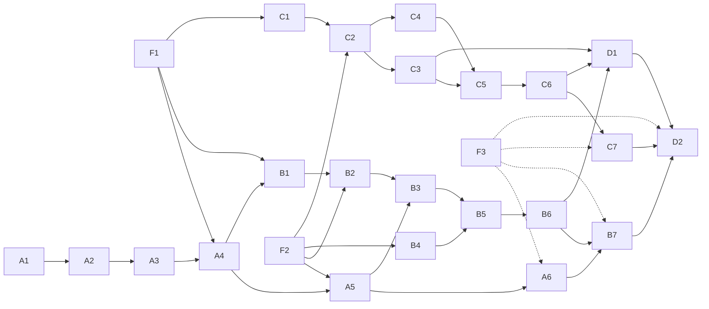

# Execution plan: NUMA placement, two-socket tensor parallelism and batched prefill

Plan date: 1 November 2026. Status as of 7 November 2026: Waves 1 and 2 (M1, M2) are complete and validated on the
cluster, apart from the A6 campaign. In Wave 3, B1-B6 (two-socket tensor parallelism) and C4-C7 (AMX enablement, the BF16
precision mode, batched Q8 with AMX-INT8, the campaign scripts) are implemented and tested locally, B on the virtual
topology and C on macOS against instruction models, with none of that code yet run on the cluster; B7 and Waves 4-5 (D)
have not started. See the milestone table in §4 and each phase document's status line.
Baseline tree: `feature/simd-kernels` at `5bc2b8c`. The plan was executed on the integration branch
`feature/numa-tp-prefill`, which was closed on 7 November 2026 when everything was merged into `develop`; work now
continues from `develop`.

This folder turns three features into phases that can each be implemented and reviewed
on their own:

1. Explicit NUMA weight placement.
2. Splitting the model and KV cache across both sockets (tensor parallelism).
3. Batched prefill, and with it AMX.

[`docs/numa-tensor-parallel-study.md`](../numa-tensor-parallel-study.md) is the design
rationale for the first two. These documents cite it by section (study §N) and do not
repeat it. The study gives the "why"; the plans give the "how", "when" and "how we
know it worked".

## 1. Why now

All numbers below are **measured** on cresco8-hbm14 (Flat mode), Slurm job 5621182,
reported in [`docs/kernels.md`](../kernels.md):

| Configuration, 8B | FP32 tok/s | Q8_0 tok/s |
| --- | ---: | ---: |
| 56 threads, socket 0, weights staged in local HBM | 14.90 | 44.49 |
| 56 threads, socket 0, weights in local DDR | 8.31 | 28.51 |
| 112 threads, both sockets, weights on HBM node 2 | 6.42 | 21.28 |
| 112 threads, both sockets, weights interleaved on HBM 2,3 | 8.17 | 26.16 |

These numbers support four conclusions:

- **One socket uses 81% of its local HBM read bandwidth for FP32** (447 of 552 GB/s).
  The second socket's HBM is the next bandwidth source.
- **Simply adding the second socket's threads makes decode slower.** Weights need
  socket ownership, not more threads.
- **Weight placement is enforced only from outside the engine.** Today it comes from
  staging the checkpoint in `/dev/shm` under `numactl --membind`
  (`scripts/cresco8-kernels.sbatch:152-154`). The engine maps the file read-only
  (`src/runtime.c:253`) and cannot check where its pages live.
- **Prefill runs one GEMV per prompt token** (`src/app.c:209-214`). The roofline puts
  prefill headroom at two to three orders of magnitude (**modeled**,
  [`docs/hbm-roofline.md`](../hbm-roofline.md) §4), and that headroom needs batching
  and then AMX.

## 2. Folder layout

| Folder | Track | Purpose |
| --- | --- | --- |
| [`00-foundations/`](00-foundations/) | F | Shared interfaces that every track uses: tensor manifest, worker teams, reporting and campaign scripts |
| [`A-numa-placement/`](A-numa-placement/README.md) | A | Explicit, verified weight/KV placement on **one** socket |
| [`B-tensor-parallel/`](B-tensor-parallel/README.md) | B | One model instance split across both sockets: head/FFN-channel shards, socket-local KV, two reductions per layer |
| [`C-batched-prefill/`](C-batched-prefill/README.md) | C | Batched prefill on **one** socket: AVX-512 FP32 GEMM, then AMX-BF16, then AMX-INT8 |
| [`D-integration/`](D-integration/README.md) | D | Two-socket batched prefill, final campaign and decision |

Placement (A) and tensor parallelism (B) are deliberately separate. A proves that the
engine can own and verify memory placement with no change in computation, and its exit
gate is a one-socket result. B changes the computation (partitioned tensors,
reductions) and builds on A's regions.

## 3. Phase index

| ID | Phase | Depends on | Cluster run |
| --- | --- | --- | --- |
| F1 | [Tensor manifest](00-foundations/F1-tensor-manifest.md) | — | none |
| F2 | [Worker teams](00-foundations/F2-worker-teams.md) | — | `check`: one team vs OpenMP |
| F3 | [Reporting and campaigns](00-foundations/F3-reporting-and-campaigns.md) | — | `check`: dry run of script library |
| A1 | [Topology discovery](A-numa-placement/A1-topology-discovery.md) | — | `check`: topology dump |
| A2 | [Bound regions](A-numa-placement/A2-bound-regions.md) | A1 | `check`: bind on each node |
| A3 | [Placement verification](A-numa-placement/A3-placement-verification.md) | A2 | `check`: 8 GiB per node, full page query |
| A4 | [Owned weight loader](A-numa-placement/A4-owned-weight-loader.md) | F1, A3 | `check`: bitwise logits, startup cost |
| A5 | [KV and workspace placement](A-numa-placement/A5-kv-and-workspace-placement.md) | A4, F2 | `check`: KV residency |
| A6 | [One-socket placement campaign](A-numa-placement/A6-one-socket-placement-campaign.md) | A5, F3 | `bench` |
| B1 | [Shard descriptors and packing](B-tensor-parallel/B1-shard-descriptors-and-packing.md) | F1, A4 | `check`: reconstruction on 8B |
| B2 | [Partial-output kernels](B-tensor-parallel/B2-partial-output-kernels.md) | B1, F2 | `check`: kernel tests |
| B3 | [Socket-local KV and attention](B-tensor-parallel/B3-socket-local-kv-and-attention.md) | B2, A5 | `check` |
| B4 | [Cross-socket reduction](B-tensor-parallel/B4-cross-socket-reduction.md) | F2 | `check`: stress and latency |
| B5 | [Two-socket FP32 forward](B-tensor-parallel/B5-two-socket-fp32-forward.md) | B3, B4 | `check`: 1B/8B logit agreement |
| B6 | [Two-socket Q8](B-tensor-parallel/B6-two-socket-q8.md) | B5 | `check`: Q8 agreement |
| B7 | [Two-socket decode campaign](B-tensor-parallel/B7-two-socket-decode-campaign.md) | B6, A6 | `bench` |
| C1 | [Batched forward API](C-batched-prefill/C1-batched-forward-api.md) | F1 | `check`: bitwise vs per-token |
| C2 | [AVX-512 FP32 GEMM](C-batched-prefill/C2-avx512-fp32-gemm.md) | C1, F2 | `check` + short M sweep |
| C3 | [Batched causal attention and KV](C-batched-prefill/C3-batched-causal-attention-and-kv.md) | C2 | `check` |
| C4 | [AMX enablement](C-batched-prefill/C4-amx-enablement.md) | C2 | `check`: AMX kernel tests |
| C5 | [AMX-BF16 precision mode](C-batched-prefill/C5-amx-bf16-precision-mode.md) | C3, C4 | `check`: BF16 error record |
| C6 | [AMX-INT8 for Q8_0](C-batched-prefill/C6-amx-int8-q8.md) | C5 | `check`: INT8 agreement |
| C7 | [One-socket prefill campaign](C-batched-prefill/C7-one-socket-prefill-campaign.md) | C6, F3 | `bench` |
| D1 | [Two-socket batched prefill](D-integration/D1-two-socket-batched-prefill.md) | B6, C3, C5, C6 | `check` + M sweep |
| D2 | [Final campaign and decision](D-integration/D2-final-campaign-and-decision.md) | D1, B7, C7 | `bench` |

A6 does not block C. C7 runs on anon HBM if A6 is done, otherwise on staged
`/dev/shm` weights, and records which.

## 4. Dependency graph and waves

| Wave | Phases | Milestone and gate |
| --- | --- | --- |
| 1 | F1, F2, F3, A1, A2, A3 | **M1**: teams match OpenMP on one socket; bound regions verified on all four nodes |
| 2 | A4, A5, A6 alongside C1, C2, C3 | **M2**: engine-owned HBM placement matches staged baseline; batched FP32 prefill matches per-token |
| 3 | B1–B7 alongside C4–C7 | **M3**: two-socket decode result (B7); one-socket AMX prefill result (C7) |
| 4 | D1 | **M4**: two-socket prefill agrees with one-socket batched reference |
| 5 | D2 | **M5**: final crossover report and go/no-go per feature |

Milestone status:

| Milestone | Status | Evidence |
| --- | --- | --- |
| M1 | **complete** (2026-11-07) | Teams match OpenMP on one socket: [F2](00-foundations/F2-worker-teams.md) cluster results (agreement 2.5e-5, decode +4% to +11%, Hugging Face gate under `teams` passes for 1B and 8B FP32). Bound regions verified on all four nodes: [A3](A-numa-placement/A3-placement-verification.md) results. `make test` is green on Linux. Not part of M1 and still open: the F3 acceptance comparison with the kernels script |
| M2 | **complete** (2026-11-07) | Engine-owned HBM placement is bitwise identical to the staged baseline on 1B and 8B, FP32 and Q8_0, `omp` and `teams`, and verified on the requested node ([A4](A-numa-placement/A4-owned-weight-loader.md), [A5](A-numa-placement/A5-kv-and-workspace-placement.md) cluster results). Batched FP32 prefill matches per-token: bitwise on the reference path ([C1](C-batched-prefill/C1-batched-forward-api.md)), within 4.8e-4 max \|Δlogit\| and 100% argmax with the AVX-512 GEMM and batched attention ([C2](C-batched-prefill/C2-avx512-fp32-gemm.md), [C3](C-batched-prefill/C3-batched-causal-attention-and-kv.md)); 8B prefill at a 2048-token prompt is 10.5x faster at M = 64 with unchanged decode. Not part of M2's gate and still open: the A6 campaign |
| M3 | **partly validated on the cluster** (2026-11-08) | Track B on hardware: shard reconstruction and placement ([B1](B-tensor-parallel/B1-shard-descriptors-and-packing.md)), kernels, attention split and the cross-socket exchange (bitwise, 47-60 µs per reduction, above the 42 µs budget: [B4](B-tensor-parallel/B4-cross-socket-reduction.md)), and the two-socket FP32 and W8A32 forward agreeing with one socket to 1e-5 ([B5](B-tensor-parallel/B5-two-socket-fp32-forward.md), [B6](B-tensor-parallel/B6-two-socket-q8.md)); **two-socket decode is currently slower than one socket** (8B FP32 11.3 against 14.6-14.9 tok/s), cause not yet found. Track C on real AMX: the tile kernels and the BF16 and INT8 prefill work ([C4](C-batched-prefill/C4-amx-enablement.md), [C5](C-batched-prefill/C5-amx-bf16-precision-mode.md), [C6](C-batched-prefill/C6-amx-int8-q8.md)); 8B prefill at 2048 tokens reaches 570 tok/s (BF16) and 563 tok/s (INT8) against 174 for the FP32 GEMM and 16.5 per-token. W8A8 comparisons use a statistical gate because requantization moves the logits by a noise floor (rms 0.063) under any change of FP32 order. Open: the B7 decode campaign and the explanation of the two-socket slowdown, the C7 campaign, the Hugging Face gates of B5, B6, C5 and C6, the C5 error gate, a re-run of C6 and B6 with the corrected gates |
| M4 | planned | — |
| M5 | planned | — |

## 5. User decisions recorded for these plans

**Prefill precision ladder.** AVX-512 FP32 GEMM first, then AMX-BF16, then AMX-INT8.
Each stage is independently selectable and is validated against the reference.

**BF16 is an explicit precision mode**, including the conversion of activations.
FP32 execution never changes silently. Each socket's memory budget counts the packed
BF16 weights, plus any retained FP32 copy.

**AMX-INT8**:
- Keeps the existing Q8_0 group scales and activation-quantization semantics.
- Does W8A8 first; W8A32 stays a separate path.
- Packing and kernel interfaces stay compatible with the NUMA shards and worker teams.

**Batched prefill sequencing**:
- Batched prefill is developed and validated on one socket, alongside the NUMA
  placement work.
- It reuses the same tensor/shard descriptors and worker-team interfaces as tensor
  parallelism, so there is no separate scheduler.
- The first implementation has no dependencies.
- An explicit integration phase (D1) then covers two-socket prefill: microbatch sizing,
  causal attention, KV updates, and the two M×4096 reductions per layer. D1 requires
  numerical agreement with the single-socket reference and measures prefill and decode
  separately.

## 6. Cross-cutting design decisions

### 6.1 Backends and runtime knobs

The existing configuration is env-only (`LLAMA_KERNELS`, `LLAMA_Q8_ACTIVATIONS`). New
knobs follow the same style, and are recorded in the report (F3). With every default
below, the engine runs exactly as it does today; the OpenMP path is the
reference.

| Knob | Values | Introduced |
| --- | --- | --- |
| `LLAMA_BACKEND` | `omp` (default) \| `teams` | F2 |
| `LLAMA_TOPOLOGY` | `auto` \| `virtual:SxT` \| `explicit:C0/H0/D0,C1/H1/D1` | F2 (virtual), A1 (auto, explicit) |
| `LLAMA_PLACEMENT` | `file` (default) \| `ddr` \| `hbm` | A4 |
| `LLAMA_THP` | `off` (default) \| `on` | A2 |
| `LLAMA_SOCKETS` | `1` (default) \| `2` | B5 |
| `LLAMA_PREFILL_BATCH` | `1` (default, per-token) \| M | C1 |
| `LLAMA_PREFILL_LOGITS` | `last` (default) \| `all` (diagnostic) | C1 |
| `LLAMA_KERNELS` | adds `amx` | C4 |
| `LLAMA_PRECISION` (`run` only) | `fp32` (default) \| `bf16` | C5 |

`virtual:SxT` creates S unpinned teams of T threads that use the portable allocator.
It runs the complete team, shard and reduction logic on macOS and in sanitizers, so
the cluster only has to establish placement and performance.

### 6.2 New modules

The study proposes these names (study §11):

| File | Responsibility | Phase |
| --- | --- | --- |
| `src/shards.c`, `include/shards.h` | Tensor manifest, shard views, row/column/scale packing, AMX packing hooks | F1, B1, C5, C6 |
| `src/workers.c`, `include/workers.h` | Persistent pthread teams, pinning, barriers, cross-socket reduction | F2, B4 |
| `src/numa.c`, `include/numa.h` | Topology discovery, bound regions, placement verification | A1–A3 |
| `src/gemm.c` | Batched AVX-512 and AMX kernels (AMX target attribute isolated here) | C2, C4–C6 |

`runtime.c` keeps validation and shared accounting. `run.c` and `runq.c` keep the
forward order. The row-range helpers in `kernels_simd.c` must be callable without
opening a parallel region.

### 6.3 Build

- The `Makefile` gains `-pthread` (F2) and `MODE=tsan` (F2).
- `OPENMP=0` is supported and tested for the `teams` backend.
- Linux-only code (`mbind`, `move_pages`, `get_mempolicy`, `pthread_setaffinity_np`,
  `arch_prctl`) sits behind `#ifdef __linux__` with a portable fallback, so macOS
  builds and runs the scalar and virtual-topology tests.
- No new third-party libraries are added. libnuma, memkind, oneDNN, BLAS and MPI are
  all excluded (study §1).

### 6.4 Numerical gates (initial values)

Each phase records the error it observes, next to the gate.

| Comparison | Gate | Origin |
| --- | --- | --- |
| Kernels vs double reference | `2e-5·Σ|w·x| + 1e-6` | `tests/kernels.c:64-85` |
| Synthetic fixture logits | `rel 2e-5`, `abs 2e-6` | `tests/test_runtime.py:54-65` |
| Placement-only changes (A4, A5) | **bitwise** identical logits | same kernels, same summation order |
| C1 reference batched path vs per-token | **bitwise** identical logits | same kernels per row |
| `k_quantize` reuse in any new path | **bitwise** identical int8 values and scales | `tests/kernels.c:299-308` |
| Real model, FP32 TP or GEMM vs one-socket per-token | max\|Δlogit\| ≤ 1e-3, argmax 100% | `tools/validate.py` default budget |
| Real model vs HF (unchanged gate) | `--max-abs 1e-3 --rtol 1e-3` FP32 | `tools/validate.py:30-32` |
| BF16 mode | recorded separately; provisional gate fixed in C5 | never judged against the FP32 budget |
| Q8 paths | recorded (non-gating vs HF, as today); gated against the one-socket Q8 path | `scripts/cresco8-kernels.sbatch:86-112` |

### 6.5 Cluster conventions

- **Node and mode.** All placement, TP and prefill runs use the Flat-mode node with
  the existing Flat-mode check (`scripts/cresco8-kernels.sbatch:54-67`). Each run is
  `--exclusive --mem=0 --cpus-per-task=112`, and the partition and node list are
  passed at submission.
- **Scripts.** F3 factors `scripts/lib/cresco8-common.sh` out of
  `cresco8-kernels.sbatch`, and each track gets one sbatch:

  | Script | Phases |
  | --- | --- |
  | `cresco8-placement.sbatch` | A |
  | `cresco8-tp.sbatch` | B |
  | `cresco8-prefill.sbatch` | C and D |

  Each script has `STAGE=check|bench`. `check` builds, tests and validates only.
- **Gating.** Correctness gates run first, and a failure stops the benchmark (except
  the recorded-only Q8 vs HF comparison).
- **Repeats.** Three independent launches per headline configuration. Reports give
  medians and full ranges.
- **Repository hygiene.** Hosts, gateways and credentials never go into the repo.
  Model paths come only from `MODELS="NAME:ARTIFACTS:HF ..."`.
- **Submission.** Every submission or cancellation needs the user's explicit go-ahead
  for that job.
- **Login node.** Builds and tests run inside the job, never on the login node.

### 6.6 Branches, commits and records

- The plan lived on the integration branch `feature/numa-tp-prefill` (closed 2026-11-07, merged into `develop`), cut from
  `feature/simd-kernels` at `5bc2b8c` so that the AVX-512 kernels the plans cite are
  present. Kernel work continues separately on `feature/simd-kernels`, and is merged
  into the integration branch when a phase needs it.
- One branch per phase off `develop` (earlier phases: off `feature/numa-tp-prefill`), named
  `feature/<track>-<id>-<slug>` (for example `feature/numa-a2-bound-regions`). Each
  phase merges back into `develop`.
- Conventional commits (`feat:`, `test:`, `docs:`, `fix:`, `chore:`).
- Each campaign phase produces a results document with a `-validation` companion,
  following `docs/phase2.md` and `docs/phase2-validation.md`. Each result cites date,
  node, compiler, job ID, commit and campaign directory.
- When a phase finishes, update its status line and the milestone table above.

## 7. Phase document template

Every phase file has these sections, in this order:

1. **Goal and status**: what changes, the status (planned / in progress / done) and
   the branch.
2. **Depends on / unblocks**.
3. **Reuse**: existing code with `file:line`, checked against `5bc2b8c`.
4. **Changes**: files, types, APIs, knobs.
5. **Local tests**: what runs on macOS and what is Linux-, AVX- or AMX-only.
6. **Cluster run**: script, stage, matrix, expected duration, outputs. Submitting
   needs the user's go-ahead.
7. **Exit criteria**.
8. **Risks and open questions**.
9. **Not in this phase**.

Numbers are labelled **measured**, **modeled** or **estimated**, as in
`docs/hbm-roofline.md`.

## 8. Out of scope for all phases

These study items stay out of every phase here:

- A BF16 checkpoint format, and BF16 KV cache storage (study step 6). C5 converts FP32
  checkpoints at load time and changes no file format.
- KV tiering across HBM and DDR, multi-request scheduling and batched decode (study
  step 7, except prefill).
- Distributed top-k/top-p sampling.
- SNC or other multi-node-per-socket layouts.
- More than two sockets.
